# Azure Machine Learning Managed Feature Store — Talk Track and Reference

Source material for a Copilot-generated slide deck and for the feature store demo in this folder.

- **Part 1 — Talk track:** generated slide content covering creation, offline and online materialization, compute, training, inference, permissions, and connectivity. Every slide cites its sources.
- **Part 2 — Microsoft Learn reference content:** the complete content of the eight PDFs in [AzureMLDocumentation](AzureMLDocumentation/), with figures extracted from those PDFs.
- **Part 3 — Extracted images:** every figure and page image extracted from the PDFs.

## How this document was produced

- **Figures:** extracted directly from the PDFs at original resolution; transparent images are preserved.
- **Page images:** every PDF page rendered to PNG at 150 DPI.
- **Reference text:** the published Microsoft Learn Markdown source for the same eight pages ([MicrosoftDocs/azure-ai-docs](https://github.com/MicrosoftDocs/azure-ai-docs/tree/main/articles/machine-learning)), converted from Learn-specific syntax to standard Markdown. Embedded notebook snippets are resolved from the official [featurestore_sample](https://github.com/Azure/azureml-examples/tree/65eceac7ff5cd2417af5f24d38192ab8e445dd85/sdk/python/featurestore_sample). Word-level comparison against the PDF text shows 96–99.5% coverage per page; the remaining differences are table reading order, code line wrapping, and page headers and footers.
- **Talk track:** generated for this workshop and grounded in the Learn pages, the Learn tutorials, and the official sample at commit `65eceac` (identical to `main` at `86d53a3` for `featurestore_sample`).

## Using this file with Copilot to create slides

1. Use Part 1 only for the main deck: one slide per `#### Slide` heading.
2. Use **Key points** as slide bullets, **Visual** as the slide graphic, and **Speaker notes** as presenter notes.
3. Use Part 2 and Part 3 for appendix slides and Q&A backup.
4. Mermaid blocks render in VS Code and GitHub. If your slide tool can't render Mermaid, ask it to redraw the diagram as native shapes.

Example prompt: *"Create a presentation from Part 1 of FEATURE_STORE_TALK_TRACK.md. Create one slide per 'Slide' heading, use the referenced images, keep at most five bullets per slide, and put speaker notes in the notes pane."*

## Part 1 — Talk track

Each `#### Slide` heading below is one slide. Use **Key points** as slide bullets, **Visual** as the slide graphic, and **Speaker notes** as presenter notes. Items labeled **Recommendation** are workshop guidance, not Microsoft documentation.

### Section A — Why a managed feature store

#### Slide 1 — Managed feature store in Azure Machine Learning

**Subtitle:** From feature definition to offline and online materialization, training, inference, security, and connectivity

**Key points**
- Follow one feature set end to end: define, register, materialize, retrieve, train, and serve
- Compare what runs on your computer and what runs on Azure Machine Learning managed Spark
- Close with the permissions and network paths between project workspaces and the feature store

**Visual:** 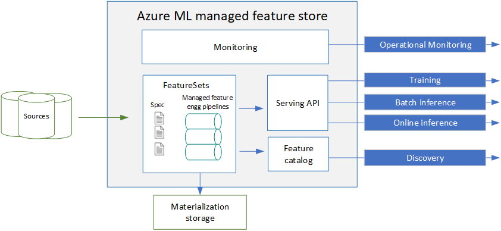

**Speaker notes:** Today we follow the official Microsoft sample: a `transactions` feature set with three-day and seven-day rolling aggregates, keyed by `accountID`. We create it, materialize it offline and online, use it for training, and then for batch and online inference. We finish with the operational questions: who needs which role, and how a project workspace reaches a feature store.

**Sources:** [What is managed feature store?](https://learn.microsoft.com/azure/machine-learning/concept-what-is-managed-feature-store?view=azureml-api-2) · [Official featurestore_sample](https://github.com/Azure/azureml-examples/tree/65eceac7ff5cd2417af5f24d38192ab8e445dd85/sdk/python/featurestore_sample)

#### Slide 2 — Agenda and end-to-end flow

**Key points**
1. Concepts: features, feature store, entities, feature sets, retrieval specifications
2. Feature set specifications and transformations
3. Materialization: offline, online, backfill, recurrent, and where jobs run
4. Retrieval: point-in-time joins and feature retrieval specifications
5. Training, batch inference, and online inference
6. Access control and identities
7. Connectivity between project workspaces and the feature store
8. Troubleshooting, demo walkthrough, and Q&A

**Visual (generated):**

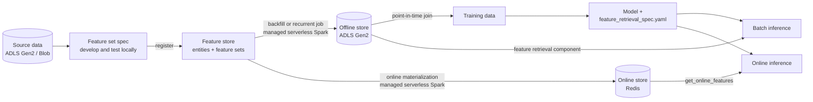

**Speaker notes:** Keep this flow on screen as the map for the session. Everything left of the materialization arrows is development and control work that you can run from your own computer. The materialization arrows are always Azure Machine Learning managed Spark jobs. The right side shows the two consumption paths: offline for training and batch, online for low-latency lookup.

**Sources:** [What is managed feature store?](https://learn.microsoft.com/azure/machine-learning/concept-what-is-managed-feature-store?view=azureml-api-2) · [Feature retrieval specification](https://learn.microsoft.com/azure/machine-learning/feature-retrieval-concepts?view=azureml-api-2)

#### Slide 3 — What is a feature?

**Key points**
- A feature is input data for a model
- Enterprise features usually transform historical data: simple aggregates, window aggregates, row-level transforms
- Example (customer churn): `7day_transactions_sum`, `7day_complaints_sum`
- Without a shared platform, teams duplicate this logic and training code drifts from serving code

**Speaker notes:** Both example features aggregate the previous seven days of data. That time dimension is what makes features hard: training must see values as they were at the time of each label, while inference needs the latest values.

**Sources:** [What is managed feature store? — What are features?](https://learn.microsoft.com/azure/machine-learning/concept-what-is-managed-feature-store?view=azureml-api-2#what-are-features)

#### Slide 4 — Problems a feature store solves

**Key points**
- **Search and reuse features** across teams to avoid redundant work and keep predictions consistent
- **Create features with transformations** for agile feature engineering
- **Operationalize feature pipelines**: the system manages transformation and materialization pipelines
- **Maintain online/offline consistency**: one pipeline for training data and inference avoids training/serving skew

**Benefits Microsoft lists**
- Agility: discover and reuse, local development and testing, declarative materialization and backfill, prebuilt feature retrieval component and retrieval spec
- Reliability: consistent definitions, versioned and immutable feature sets, materialization monitoring, point-in-time joins to avoid leakage
- Cost: reuse across the organization; system-managed materialization and monitoring

**Speaker notes:** The primary cost driver is managed Spark materialization, and that cost is visible at the feature store level.

**Sources:** [What is managed feature store? — Problems solved / Benefits](https://learn.microsoft.com/azure/machine-learning/concept-what-is-managed-feature-store?view=azureml-api-2#problems-solved-by-feature-store)

#### Slide 5 — A feature store is a shared workspace

**Key points**
- A feature store is an Azure Machine Learning **workspace type** (`kind: FeatureStore`) that many project workspaces can use
- **Feature producers** create, monitor, and manage features in the feature store
- **Feature consumers** discover features and retrieve them for training and inference from project workspaces
- Consumers can also use Spark environments outside Azure Machine Learning, such as Azure Databricks
- Local development and testing of features is supported

**Visual:** 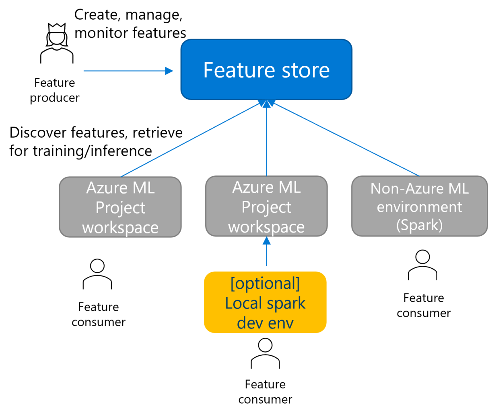

**Speaker notes:** Separating the feature store from project workspaces is the key design decision. It is what lets several teams reuse one governed feature catalog, and it is also why permissions and networking span two workspaces.

**Sources:** [What is managed feature store? — Share managed feature store](https://learn.microsoft.com/azure/machine-learning/concept-what-is-managed-feature-store?view=azureml-api-2#share-managed-feature-store)

#### Slide 6 — Architecture

**Key points**
- You provide a feature set specification; the system handles serving, securing, and monitoring
- Declarative materialization settings generate and manage the materialization pipelines
- **Serving API** reads directly from the source (on the fly) or from the materialization store
- **Feature catalog** for search, sharing, and reuse
- **Monitoring** of materialization jobs, including email notifications

**Visual:** 

**Speaker notes:** Point out the four outputs: training, batch inference, online inference, and discovery. The rest of the session explains each arrow.

**Sources:** [What is managed feature store? — Feature store overview](https://learn.microsoft.com/azure/machine-learning/concept-what-is-managed-feature-store?view=azureml-api-2#feature-store-overview)

#### Slide 7 — Top-level entities

**Key points**
- **Feature store**: name, offline store connection, Spark runtime version (plus optional online store and materialization identity)
- **Entity**: reusable join-key definition (index columns); promotes consistency and isn't used at runtime
- **Feature set specification**: self-contained definition (source, transformation, features, index and timestamp columns) that you can develop and test locally
- **Feature set asset**: registered, versioned feature set with materialization settings and lineage
- **Feature retrieval specification**: portable list of features for a model

**Visual:** 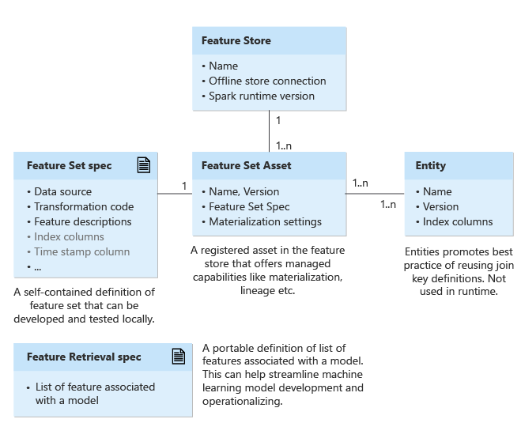

**Speaker notes:** The specification is the unit you iterate on locally. Registration turns it into a managed, versioned asset. Versions are immutable, so new model versions can adopt new feature versions without breaking older models.

**Sources:** [Top-level entities in managed feature store](https://learn.microsoft.com/azure/machine-learning/concept-top-level-entities-in-managed-feature-store?view=azureml-api-2)

### Section B — Defining features

#### Slide 8 — Feature set specification

**Key points**
- `source`: type, path, mandatory `timestamp_column`, and `source_delay`
- `feature_transformation`: transformer code folder and class (or a DSL definition)
- `features` and `index_columns`: output schema
- `source_lookback`: how far back the source must be read to compute a value at time T
- `temporal_join_lookback`: how far back a point-in-time join may look for a value
- `to_spark_dataframe(start, end)` reads `[start - source_lookback, end)`, applies the transformer, and returns rows in `[start, end)`

**Visual:** 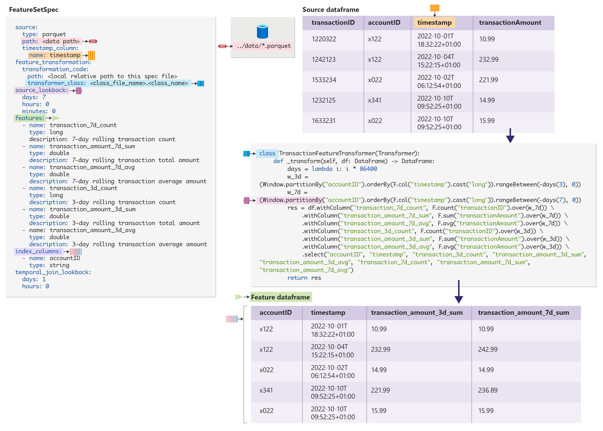

**Speaker notes:** The `featurestore` SDK generates this YAML from `create_feature_set_spec(...)`. The official sample uses a seven-day `source_lookback` because its largest rolling window is seven days, and a one-day `temporal_join_lookback`.

**Sources:** [Feature transformation and best practices — Define a feature set](https://learn.microsoft.com/azure/machine-learning/feature-set-specification-transformation-concepts?view=azureml-api-2#define-a-feature-set)

#### Slide 9 — Transformations and lookback best practices

**Key points**
- Row-level transformation: `source_lookback = 0`
- Sliding window: the largest window range (for example, 7 days for 3- and 7-day rolling features)
- Tumbling or stagger window: the `windowDuration` value
- Prevent leakage: a feature value at time T must use only data available before T
- A lookback that's too short produces incorrect values; one that's too long wastes compute

**Visual:** 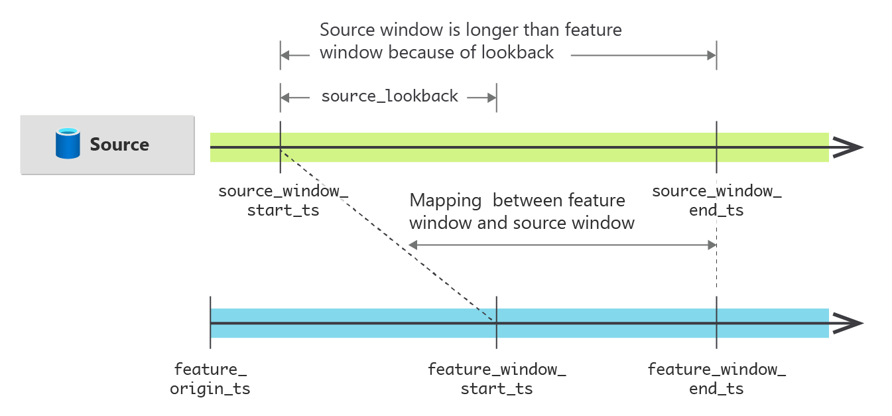

**Speaker notes:** Walk through the sliding-window example: to produce seven-day sums for the feature window, the job must read seven additional days of source data before the window starts.

**Sources:** [Feature transformation and best practices — Best practices](https://learn.microsoft.com/azure/machine-learning/feature-set-specification-transformation-concepts?view=azureml-api-2#define-feature-transformations---best-practices)

### Section C — Materialization

#### Slide 10 — Materialization: what and why

**Key points**
- Materialization computes feature values for a **feature window** and stores them in an offline and/or online store
- Without materialization, offline queries compute features **on the fly** from the source; this is fine for prototyping
- For production training and inference, materialize first for reliability and availability
- `get_offline_features()` uses the materialization store by default
- The **Materialization jobs** UI shows data intervals and job history for offline and online stores

**Visual:** 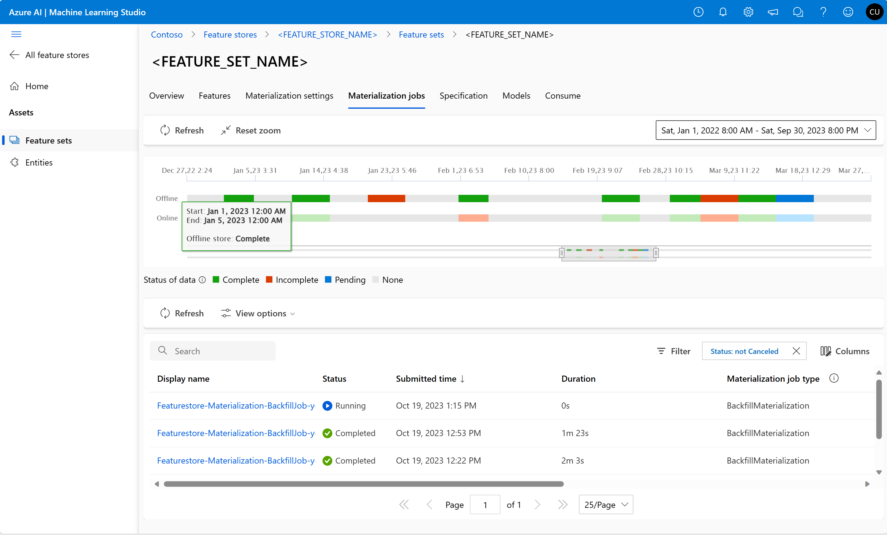

**Speaker notes:** Data intervals have four statuses: Complete (green), Incomplete (red), Pending (blue), and None (gray). A feature set can have at most 2,000 data intervals; filling gaps with backfill merges intervals and keeps you under the limit.

**Sources:** [Feature set materialization concepts](https://learn.microsoft.com/azure/machine-learning/feature-set-materialization-concepts?view=azureml-api-2) · [Tutorial 1 — Backfill](https://learn.microsoft.com/azure/machine-learning/tutorial-get-started-with-feature-store?view=azureml-api-2)

#### Slide 11 — Backfill and recurrent materialization

**Key points**
- Enable offline and/or online materialization on the feature set (`MaterializationSettings`)
- **Backfill**: manual job by data status (`None`, `Incomplete`, `Complete`) within a feature window, or by the job ID of a failed or canceled job
- The first backfill must specify both feature window start and end
- **Recurrent**: schedule (`interval`, `frequency`, `start_time`) produces `[trigger - source_delay - interval, trigger - source_delay)`
- Disabling materialization resets status to `None` and makes materialized data unusable

**Visual:** 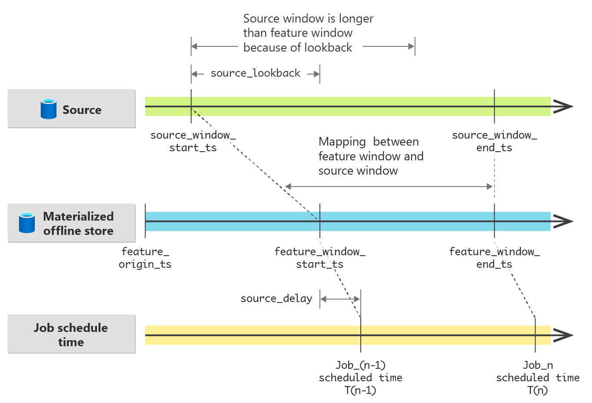

**Official sample code (Tutorial 1):**

```python
from datetime import datetime
from azure.ai.ml.entities import DataAvailabilityStatus

st = datetime(2022, 1, 1, 0, 0, 0, 0)
et = datetime(2023, 6, 30, 0, 0, 0, 0)

poller = fs_client.feature_sets.begin_backfill(
    name="transactions",
    version="1",
    feature_window_start_time=st,
    feature_window_end_time=et,
    data_status=[DataAvailabilityStatus.NONE],
)
print(poller.result().job_ids)
```

**Speaker notes:** `source_delay` models upstream latency: an event at time t lands in source at t + x. Setting it correctly keeps recurrent jobs from materializing windows whose data hasn't arrived yet.

**Sources:** [Feature set materialization concepts — Data materialization jobs](https://learn.microsoft.com/azure/machine-learning/feature-set-materialization-concepts?view=azureml-api-2#data-materialization-jobs) · [Tutorial 3 — Recurrent materialization](https://learn.microsoft.com/azure/machine-learning/tutorial-enable-recurrent-materialization-run-batch-inference?view=azureml-api-2)

#### Slide 12 — Offline store and online store

| | Offline store | Online store |
|---|---|---|
| Storage | ADLS Gen2 container (created by default with the feature store, or bring your own) | Redis attached to the feature store (this demo: Azure Managed Redis) |
| Contents | Feature history (time series) | Latest feature values per entity key; each value expires after the feature set's `temporal_join_lookback` |
| Used for | Training data with point-in-time joins; batch inference | Low-latency lookup for online inference |
| Read API | `get_offline_features()` in Spark, or the built-in feature retrieval component | `init_online_lookup()` + `get_online_features()` in Python (pyarrow) |
| Populated by | Backfill and recurrent materialization jobs | The same jobs with `online_enabled=True`; online data bootstraps from `Complete` offline intervals |

**Key points**
- A feature store is always created with an offline store and a user-assigned managed identity (UAI); without parameters, the system creates both and assigns the UAI's RBAC on the offline store
- Microsoft lists both offline (ADLS Gen2) and online (Redis) materialization as supported
- Azure Cache for Redis has a retirement timeline for all SKUs, and **creating it is now rejected in this subscription** ("Azure Cache for Redis is retiring, create Azure Managed Redis instance instead")
- This demo uses **Azure Managed Redis** (Balanced B0): the installed `azureml-featurestore` 1.2.2 online-lookup client accepts `Microsoft.Cache/RedisEnterprise/{name}/databases/{db}` IDs as well as `Microsoft.Cache/Redis/{name}`

**Speaker notes:** Online bootstrapping saves compute: when online materialization is enabled after offline materialization, the online job reuses offline values with `Complete` status instead of recomputing them.

**Sources:** [Tutorial 1 — Feature store creation defaults](https://learn.microsoft.com/azure/machine-learning/tutorial-get-started-with-feature-store?view=azureml-api-2) · [Feature set materialization concepts — Online data bootstrap](https://learn.microsoft.com/azure/machine-learning/feature-set-materialization-concepts?view=azureml-api-2#online-data-bootstrap) · [Tutorial 4 — Online materialization](https://learn.microsoft.com/azure/machine-learning/tutorial-online-materialization-inference?view=azureml-api-2)

#### Slide 13 — Where does each step run? Local computer vs. serverless Spark

| Activity | Your computer (local Spark/Python) | Azure ML (serverless Spark unless noted) |
|---|---|---|
| Develop and test a feature set spec (`to_spark_dataframe`) | **Yes**, with local Spark on data it can read (this demo uses a local copy) | **Yes**, in a Serverless Spark Compute notebook session (official tutorials) |
| Register entities and feature sets; enable materialization; set schedules; submit backfills | **Yes** — SDK control-plane calls, no Spark | **Yes** |
| **Execute offline materialization** (backfill or recurrent) | **No** — you submit backfills and set schedules; the service runs the jobs | **Yes, always** |
| **Execute online materialization** (to Redis) | **No** — same managed Spark jobs | **Yes, always** |
| Point-in-time retrieval `get_offline_features()` | **Yes** on feature set specs over local data. For registered features, local Spark needs its own storage credentials; your Microsoft Entra sign-in isn't enough | **Yes**, in a Spark session or with the built-in feature retrieval component in pipelines |
| Online lookup `init_online_lookup()` + `get_online_features()` | **Yes** — plain Python, no Spark. Needs network access to Redis, `listKeys` on Redis, and read access to the feature store and its storage | **Yes** — managed online endpoints (their own compute, not Spark) or any Azure ML Python session |

**Key points**
- Microsoft: "Azure Machine Learning managed Spark (in serverless compute instances) runs the materialization jobs"
- You control the **size** of materialization compute — `MaterializationComputeResource(instance_type=...)` and `spark_configuration` — not its location
- Microsoft: "With a Spark environment, you can fully develop and test feature sets locally." In the Learn tutorials, "locally" means the notebook's own Spark session, which is a Serverless Spark Compute session; this demo uses a laptop instead
- The online lookup client gets the Redis host and access key through Azure Resource Manager (`listKeys`) and connects with the key, so Redis must allow access keys
- Validated in this demo: spec development and point-in-time joins on local data, all control-plane calls from a laptop, offline and online materialization on serverless Spark, retrieval in the training and batch pipelines, and online lookup both locally and from a managed online endpoint
- Materialization runs on Spark. Learn says to use Apache Spark 3.4 or later; in this demo, materialization on 3.4 failed and the service reported runtimes below 3.5 as unsupported, so use **3.5**

**Visual (generated):**

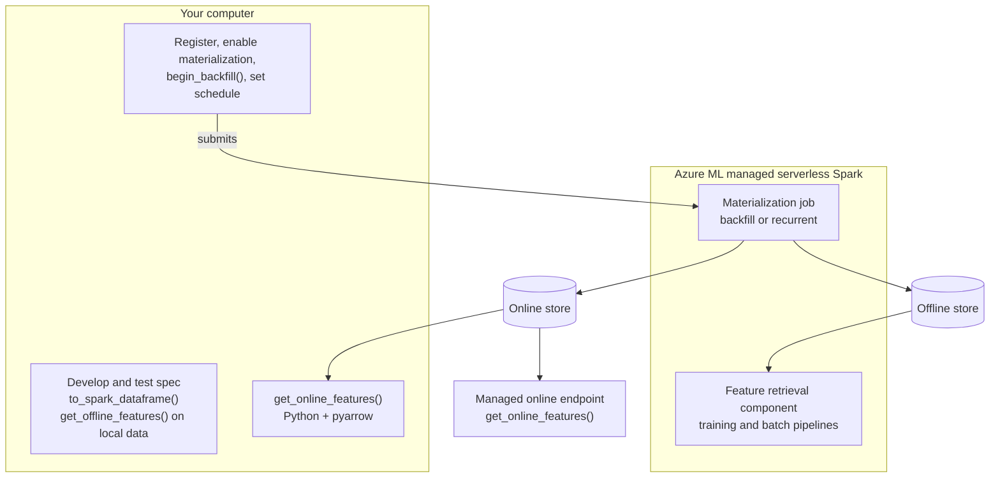

**Speaker notes:** This answers the most common question. You can drive everything from a laptop: create the store, register the feature set, enable materialization, and trigger backfills. The materialization itself, both offline and online, always executes as an Azure Machine Learning managed Spark job owned by the feature store. Locally, you prototype transformations, run point-in-time joins on local data, and look up online features. A Windows laptop needs Java, PySpark, and the Hadoop Windows binaries. Local Spark can't use your Microsoft Entra identity to read ADLS Gen2, so develop on a local sample and read registered, materialized data on serverless Spark or through online lookup.

**Sources:** [What is managed feature store? — Feature materialization](https://learn.microsoft.com/azure/machine-learning/concept-what-is-managed-feature-store?view=azureml-api-2#feature-materialization) · [Feature set materialization concepts](https://learn.microsoft.com/azure/machine-learning/feature-set-materialization-concepts?view=azureml-api-2#data-materialization-jobs) · [Tutorial 1](https://learn.microsoft.com/azure/machine-learning/tutorial-get-started-with-feature-store?view=azureml-api-2)

#### Slide 14 — Materialization identity and compute settings

**Key points**
- Materialization jobs use the feature store's **materialization identity** (a UAI) to read sources and write stores
- Required roles: `AzureML Data Scientist` on the feature store, `Storage Blob Data Reader` on source storage, `Storage Blob Data Contributor` on the offline store
- For an online store, the feature store update assigns the UAI's RBAC only when the materialization identity, offline target, or online target changes; `grant_materialization_permissions=True` alone isn't enough
- Compute is configured per feature set, as in the official sample

**Official sample code (Tutorial 1):**

```python
transactions_fset_config.materialization_settings = MaterializationSettings(
    offline_enabled=True,
    resource=MaterializationComputeResource(instance_type="standard_e8s_v3"),
    spark_configuration={
        "spark.driver.cores": 4,
        "spark.driver.memory": "36g",
        "spark.executor.cores": 4,
        "spark.executor.memory": "36g",
        "spark.executor.instances": 2,
        "spark.sql.shuffle.partitions": 1,
    },
    schedule=None,
)
```

**Speaker notes:** `spark.sql.shuffle.partitions` controls how many Parquet files are written per day in the offline store. Too many small files slow offline retrieval. Confirm serverless Spark vCPU quota for the instance type in the feature store region.

**Sources:** [Manage access — Materialization managed identity](https://learn.microsoft.com/azure/machine-learning/how-to-setup-access-control-feature-store?view=azureml-api-2#permissions-required-for-the-feature-store-materialization-managed-identity-role) · [Tutorial 4 — Attach online store note](https://learn.microsoft.com/azure/machine-learning/tutorial-online-materialization-inference?view=azureml-api-2) · [Tutorial 1](https://learn.microsoft.com/azure/machine-learning/tutorial-get-started-with-feature-store?view=azureml-api-2)

### Section D — Retrieval and training

#### Slide 15 — Point-in-time join

**Key points**
- Observation data contains entity keys, an event timestamp, and (for training) the label
- For each observation, the join looks for feature values from the **nearest past**
- Prevents leakage of future information into training data
- Available through `get_offline_features()` and the built-in feature retrieval component

**Visual:** 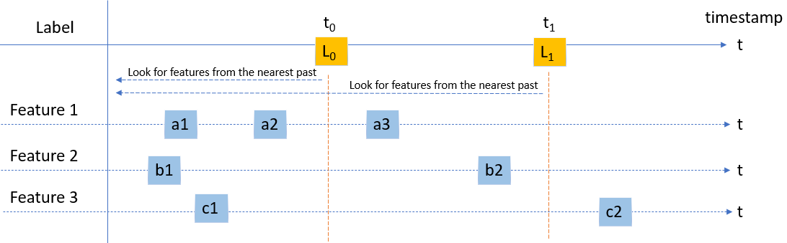

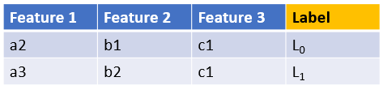

**Speaker notes:** For L0 at t0 the join returns a2, b1, and c1. For L1 at t1 it returns a3, b2, and c1: c2 occurs after t1, so it's excluded and the most recent earlier value, c1, is used.

**Sources:** [Offline feature retrieval using a point-in-time join](https://learn.microsoft.com/azure/machine-learning/offline-retrieval-point-in-time-join-concepts?view=azureml-api-2)

#### Slide 16 — `source_delay` and `temporal_join_lookback`

**Key points**
- For an observation at time `t`, the join uses the latest feature value in `[t - temporal_join_lookback, t - source_delay]`
- `source_delay` (default `0`): skips values that wouldn't have landed in the source yet, avoiding leakage
- `temporal_join_lookback` (default infinity): ignores stale values and speeds up the join
- Set `temporal_join_lookback` greater than `source_delay` to get nonempty results

**Visual:** 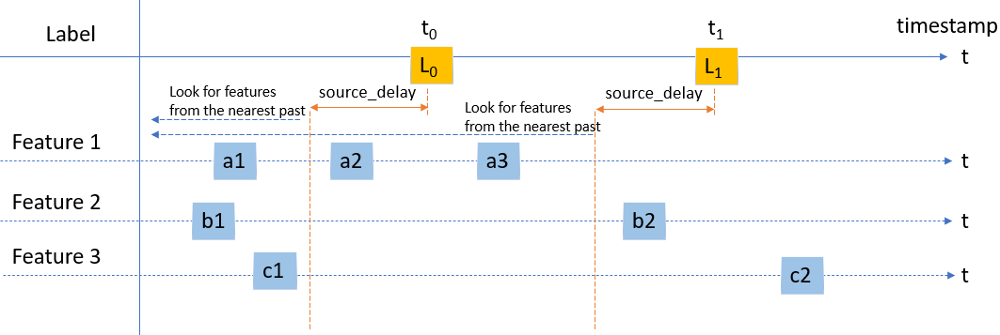

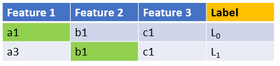

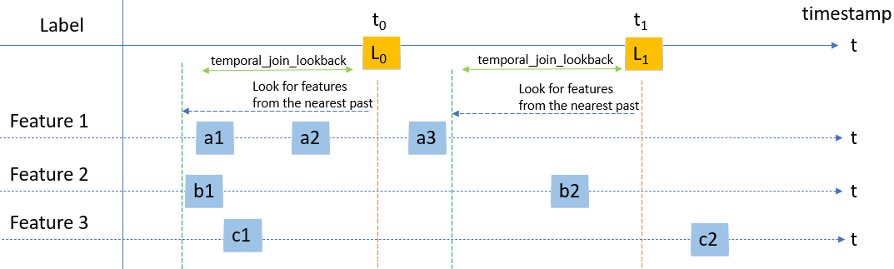

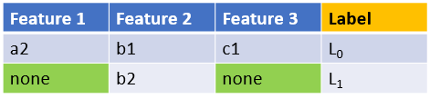

**Speaker notes:** These two settings make offline training data match what an online system would actually have seen at prediction time.

**Sources:** [Offline feature retrieval — Parameters](https://learn.microsoft.com/azure/machine-learning/offline-retrieval-point-in-time-join-concepts?view=azureml-api-2#parameters-used-by-point-in-time-join)

#### Slide 17 — Feature retrieval specification

**Key points**
- A YAML artifact listing the features a model uses; features can come from multiple feature sets and feature stores
- Created with `generate_feature_retrieval_spec(path, features)` after selecting features
- Must be packaged in the model artifact root as `feature_retrieval_spec.yaml`
- Enables lineage between registered models and feature sets
- Used by training, by the batch feature retrieval component, and by online scoring to know which features to look up

**Example (from Learn):**

```yaml
feature_stores:
  - uri: azureml://subscriptions/{sub}/resourcegroups/{rg}/workspaces/{featurestore-workspace-name}
    location: eastus
    workspace_id: {featurestore-workspace-guid-id}
    features:
      - feature_name: numPaymentRejects1dPerUser
        feature_set: accounts:1
      - feature_name: transaction_amount_7d_avg
        feature_set: transactions:1
serialization_version: 2
```

**Speaker notes:** The retrieval spec is the connective tissue between experimentation and production: the same file drives training data generation and inference lookups.

**Sources:** [Feature retrieval specification and usage in training and inference](https://learn.microsoft.com/azure/machine-learning/feature-retrieval-concepts?view=azureml-api-2)

#### Slide 18 — Training with features

**Key points**
- **Experiment**: select features (including unregistered local specs), call `get_offline_features(features, observation_df, timestamp_column)`
- **Production**: training pipeline with the built-in feature retrieval component (retrieval spec + observation data), then train, evaluate, and register the model with its retrieval spec
- Offline retrieval reads the offline store when data is materialized; otherwise it computes features from the source on the fly
- **The online store isn't a training source**: it holds only the latest value per key, without point-in-time history
- Training/serving consistency comes from using the **same registered feature set versions** for offline training and online lookup

**Speaker notes:** If the goal is to train with both materializations, the correct pattern is to train from offline features and validate online parity: the same feature set version materialized offline and online gives consistent definitions.

**Sources:** [Tutorial 2 — Experiment and train models using features](https://learn.microsoft.com/azure/machine-learning/tutorial-experiment-train-models-using-features?view=azureml-api-2) · [Feature retrieval specification — Training data](https://learn.microsoft.com/azure/machine-learning/feature-retrieval-concepts?view=azureml-api-2#use-feature-retrieval-specification-to-create-training-data)

### Section E — Inference

#### Slide 19 — Batch inference (official pattern)

**Key points**
- Recurrent materialization keeps the offline store fresh
- Batch inference pipeline:
  1. Built-in feature retrieval component; the **registered model** is its input, and the component finds `feature_retrieval_spec.yaml` in the model artifact
  2. Batch scoring step appends predictions (`predict_is_fraud`)
- Microsoft: "You use a job for batch inference in this example. You can also use batch endpoints in Azure Machine Learning."

**Speaker notes:** Batch inference observation data has no label. The feature retrieval step joins observations with features using the same point-in-time logic as training.

**Sources:** [Tutorial 3 — Enable recurrent materialization and run batch inference](https://learn.microsoft.com/azure/machine-learning/tutorial-enable-recurrent-materialization-run-batch-inference?view=azureml-api-2)

#### Slide 20 — Online inference (official pattern)

**Key points**
- Attach Redis as the online store, enable online materialization, and backfill
- Test locally with `init_online_lookup(features, credential)` and `get_online_features(features, pyarrow_table)`
- Managed online endpoint scoring script loads the retrieval spec in `init()` and looks up features per request
- Endpoint managed identity needs `Contributor` on Redis and `AzureML Data Scientist` on the feature store
- Online lookup requires `azureml-featurestore` 1.2.1 or later

**Official scoring pattern (from Learn):**

```python
from azure.identity import ManagedIdentityCredential
from azureml.featurestore import FeatureStoreClient
from azureml.featurestore import get_online_features, init_online_lookup

def init():
  credential = ManagedIdentityCredential()
  spec_path = os.path.join(os.getenv("AZUREML_MODEL_DIR"), "model_output")

  global features
  featurestore = FeatureStoreClient(credential=credential)
  features = featurestore.resolve_feature_retrieval_spec(spec_path)
  init_online_lookup(features, credential)
```

**Speaker notes:** Keys can expire from Redis. If a sample key isn't found, check existing keys in the Redis console, as the sample notes.

**Sources:** [Tutorial 4 — Online materialization and inference](https://learn.microsoft.com/azure/machine-learning/tutorial-online-materialization-inference?view=azureml-api-2) · [Feature retrieval specification — Online inference](https://learn.microsoft.com/azure/machine-learning/feature-retrieval-concepts?view=azureml-api-2#use-feature-retrieval-specification-in-online-inference)

#### Slide 21 — Batch deployment with an online feature store?

**Key points**
- No official sample deploys a **batch endpoint that reads the online store**; official batch scoring reads offline features
- It's possible: a batch deployment scoring script can reuse the official online pattern (`init_online_lookup` in `init()`, `get_online_features` per mini-batch)
- Semantics: online lookup returns **latest** values, so it scores "as of now", not historical points in time
- Requirements: batch compute identity with Redis access and `AzureML Data Scientist` on the feature store; network path from batch compute to Redis; Redis throughput and key time-to-live
- **Recommendation:** use offline retrieval for batch and online lookup for real-time; use online lookup in batch only when you deliberately need current values

**Speaker notes:** This is the main design choice for the demo. The documented path covers batch with the offline store and online with the online store. Mixing them is technically possible but is custom code.

**Sources:** [Tutorial 3](https://learn.microsoft.com/azure/machine-learning/tutorial-enable-recurrent-materialization-run-batch-inference?view=azureml-api-2) · [Feature retrieval specification — Batch inference](https://learn.microsoft.com/azure/machine-learning/feature-retrieval-concepts?view=azureml-api-2#use-feature-retrieval-specification-in-batch-inference)

### Section F — Access control

#### Slide 22 — Personas and identities

**Key points**
- **Feature store admin**: lifecycle, user access, store configuration (offline/online), quota, and cost
- **Feature set developer**: feature lifecycle, materialization and backfill setup, freshness and quality monitoring
- **Feature set consumer**: discovery, experimentation, and training/inference pipelines in a project workspace
- **Materialization managed identity**: the UAI that feature store materialization jobs use for data access
- **Workload identities** (deployment-specific): project compute or serverless Spark identity, online endpoint identity, batch compute identity
- Any identity can be a Microsoft Entra user, service principal, or managed identity

**Sources:** [Manage access — Identities and user types](https://learn.microsoft.com/azure/machine-learning/how-to-setup-access-control-feature-store?view=azureml-api-2#identities-and-user-types)

#### Slide 23 — Built-in role assignments

| Identity | Feature store | Source storage | Offline store storage | Other |
|---|---|---|---|---|
| Feature store admin | `Contributor` + `User Access Administrator` on the resource group (or a custom admin role) | — | — | `Managed Identity Operator` on the UAI (custom role path) |
| Feature set developer | `AzureML Data Scientist` | `Storage Blob Data Reader` | `Storage Blob Data Reader` | — |
| Feature set consumer | `AzureML Data Scientist` (or custom read actions) | `Storage Blob Data Reader` | `Storage Blob Data Reader` | — |
| Materialization UAI | `AzureML Data Scientist` | `Storage Blob Data Reader` | `Storage Blob Data Contributor` | Redis access assigned when the online store is attached (for Azure Managed Redis, also `Reader` on the cluster) |
| Online endpoint identity | `AzureML Data Scientist` | — | — | `Contributor` on Redis; `Storage Blob Data Reader` on the feature store default storage (identity-based system datastores) |

**Key points**
- `AzureML Data Scientist` lets users **create and update** feature sets. For read-only consumers, use custom actions: `featurestores/read`, `featuresets/read`, `featurestoreentities/read`, `datastores/listSecrets/action`, `jobs/read`
- New feature stores use identity-based system datastores (`systemDatastoresAuthMode: identity`). Validated in this demo: developers need `Storage Blob Data Contributor`, and every identity that resolves feature sets (including the online endpoint) needs `Storage Blob Data Reader`, on the feature store's default storage
- There's no ACL for individual feature sets or entities
- Allow time for RBAC propagation before retrying failed reads

**Visual (generated):**

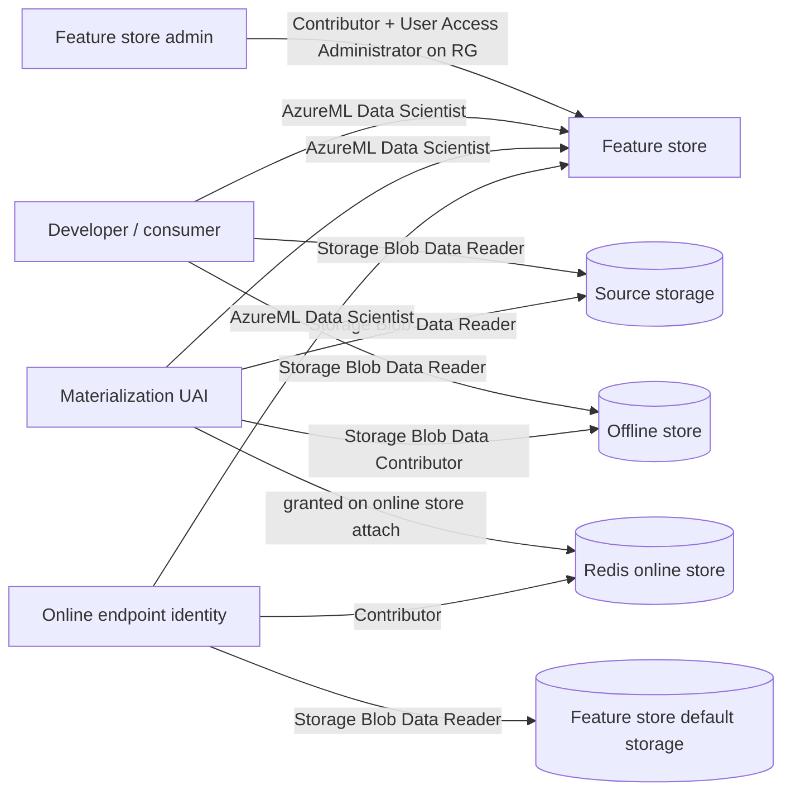

**Sources:** [Manage access to managed feature store](https://learn.microsoft.com/azure/machine-learning/how-to-setup-access-control-feature-store?view=azureml-api-2) · [Tutorial 4 — Grant RBAC](https://learn.microsoft.com/azure/machine-learning/tutorial-online-materialization-inference?view=azureml-api-2)

#### Slide 24 — Feature store actions for custom roles

| Action | Allows |
|---|---|
| `workspaces/featurestores/read` | List and get feature stores |
| `workspaces/featurestores/write` | Create and update feature stores (materialization stores, compute) |
| `workspaces/featurestores/delete` | Delete feature stores |
| `workspaces/featuresets/read` / `write` / `delete` | Read, create or update, delete feature sets |
| `workspaces/featuresets/action` | Trigger actions such as backfill |
| `workspaces/featurestoreentities/read` / `write` / `delete` / `action` | Manage entities |

All actions are under `Microsoft.MachineLearningServices/`.

**Sources:** [Manage access — New actions](https://learn.microsoft.com/azure/machine-learning/how-to-setup-access-control-feature-store?view=azureml-api-2#new-actions-created-for-managed-feature-store)

### Section G — Connectivity

#### Slide 25 — Connectivity paths

**Key points**
- The project workspace and feature store are separate workspaces; clients call both control planes
- Data paths: project compute and serverless Spark → source, offline store, and observation data; online endpoints → Redis
- Feature store materialization Spark → source, offline store, Redis, and the feature store's default key vault
- With public access, Entra ID and RBAC protect each hop; with network isolation, private endpoints carry each hop

**Speaker notes:** The isolated design has two managed virtual networks, one for the feature store and one for the project workspace, and each needs its own outbound private endpoint rules.

**Sources:** [Tutorial 6 — Network isolation for feature store](https://learn.microsoft.com/azure/machine-learning/tutorial-network-isolation-for-feature-store?view=azureml-api-2)

#### Slide 26 — Private connectivity (network isolation)

**Feature store** (`public_network_access: disabled`, managed network `allow_internet_outbound`, `provision-network`):

| Outbound private endpoint rule | Target | Subresource |
|---|---|---|
| Source, offline store, and observation data | ADLS Gen2 account | `dfs` |
| Default key vault (serverless Spark doesn't create it automatically) | Key Vault | `vault` |
| Online store | Redis | `redisCache` |

**Project workspace** (managed network `allow_internet_outbound`, provisioned with `--include-spark`):

| Outbound private endpoint rule | Target | Subresource |
|---|---|---|
| Source, offline store, and observation data | ADLS Gen2 account | `dfs` |
| Feature store default storage | Storage account | `blob` |
| Feature store default key vault | Key Vault | `vault` |
| **Feature store** | Feature store workspace | `amlworkspace` |
| Online store | Redis | `redisCache` |

All rules use `type: private_endpoint` with `spark_enabled: true`. Disable public network access on storage and Key Vault.
For Azure Managed Redis, the private endpoint subresource is `redisEnterprise`; the official notebook's `redisCache` applies to Azure Cache for Redis.

**Visual (generated):**

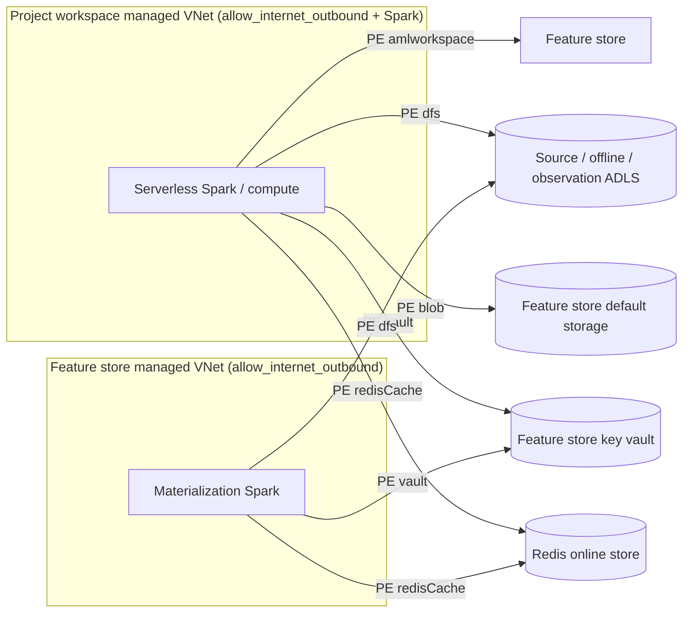

**Key points**
- Microsoft: "For your Azure Machine Learning workspace, set the `isolation_mode` to `allow_internet_outbound`. This is the only supported network isolation mode."
- **Impact on this repo:** the private MLOps and managed single-workspace designs use `AllowOnlyApprovedOutbound`. Feature store network isolation needs a design decision before production. Under approved-only outbound, Spark session Conda installation is also unsupported
- Creating the feature store requires `Owner` or `Contributor` plus `User Access Administrator`; developers need `AzureML Data Scientist` on the feature store
- Since April 30, 2025, Azure Machine Learning no longer grants itself permission to approve private endpoints on non-default resources. Grant each workspace's managed identity **Azure AI Enterprise Network Connection Approver** on every non-default target of its outbound rules (for the project workspace: the feature store, its storage and key vault, ADLS Gen2, and Redis)
- Azure Machine Learning managed networks support Azure Managed Redis as a private endpoint target (`redisEnterprise`)

**Sources:** [Tutorial 6 — Network isolation for feature store](https://learn.microsoft.com/azure/machine-learning/tutorial-network-isolation-for-feature-store?view=azureml-api-2) · [Official network isolation notebook](https://github.com/Azure/azureml-examples/blob/65eceac7ff5cd2417af5f24d38192ab8e445dd85/sdk/python/featurestore_sample/notebooks/sdk_and_cli/network_isolation/Network-isolation-feature-store.ipynb) · [Managed network — private endpoints and approval](https://learn.microsoft.com/azure/machine-learning/how-to-managed-network?view=azureml-api-2#private-endpoints) · [Azure Managed Redis with Private Link](https://learn.microsoft.com/azure/redis/private-link) · [Repo roadmap](../../../infra/single-workspace/PYSPARK_FEATURE_STORE_ROADMAP.md)

#### Slide 27 — Setup checklist: permissions and connectivity

1. Admin: `Contributor` + `User Access Administrator` on the feature store resource group
2. Create the feature store (default offline store and materialization UAI) or attach existing ADLS Gen2 and UAI
3. Developers and consumers: `AzureML Data Scientist` on the feature store; `Storage Blob Data Reader` on sources and the offline store
4. Materialization UAI: verify `AzureML Data Scientist`, `Storage Blob Data Reader` on sources, `Storage Blob Data Contributor` on the offline store
5. Online store: attach Redis through a feature store update so the UAI receives access; grant endpoint identities `Contributor` on Redis, `AzureML Data Scientist` on the feature store, and `Storage Blob Data Reader` on the feature store default storage
6. Private network: feature store and project workspace outbound private endpoint rules as on Slide 26; provision both managed networks
7. Quota: serverless Spark vCPUs for the materialization instance type in the feature store region

**Sources:** [Manage access](https://learn.microsoft.com/azure/machine-learning/how-to-setup-access-control-feature-store?view=azureml-api-2) · [Tutorial 6](https://learn.microsoft.com/azure/machine-learning/tutorial-network-isolation-for-feature-store?view=azureml-api-2)

### Section H — Operations and demo

#### Slide 28 — Troubleshooting highlights

| Area | Typical issue |
|---|---|
| Create/update feature store | ARM throttling, duplicated materialization identity ARM ID, RBAC permission errors |
| Feature set spec | Invalid schema, transformer class not found, code folder not found |
| Retrieval | Retrieval spec resolution errors, missing `feature_retrieval_spec.yaml` in the model, observations not joined, RBAC on feature store or storage, slow `get_offline_features()` |
| Online lookup | Initialization fails due to missing storage scope (upgrade to SDK 1.2.1+) |
| Materialization jobs | Invalid offline store configuration; materialization identity lacks feature store, source-read, or offline-write permissions; invalid Spark configuration |

**Speaker notes:** Most first-run failures are permissions or propagation delays. Check the materialization identity's three role assignments first.

**Sources:** [Troubleshoot managed feature store errors](https://learn.microsoft.com/azure/machine-learning/troubleshooting-managed-feature-store?view=azureml-api-2)

#### Slide 29 — Field notes: running the official sample in October 2026

| Finding | What to do |
|---|---|
| The official sample data account now rejects anonymous reads (`PublicAccessNotPermitted`, [azureml-examples#3738](https://github.com/Azure/azureml-examples/issues/3738)) | Use your own data with the same schema in ADLS Gen2 (notebook 00) |
| Materialization on the SDK's default Spark runtime (3.4) failed; the job reported that runtimes below 3.5 aren't supported | Create and update feature stores with `compute_runtime=ComputeRuntime(spark_runtime_version="3.5")`; updates without it reset the runtime |
| New feature stores use identity-based system datastores (`systemDatastoresAuthMode: identity`) | Feature set developers need `Storage Blob Data Contributor` on the feature store's default storage to register feature sets |
| The first feature store create failed while its new identity configured the key vault | Retry; identity propagation is transient. This happened on the first attempt for both feature stores we created |
| Azure Cache for Redis creation is rejected: "Azure Cache for Redis is retiring, create Azure Managed Redis instance instead" | Use Azure Managed Redis (`Microsoft.Cache/redisEnterprise`) as the online store, with access keys enabled for the feature store's lookup client |
| With Azure Managed Redis, attaching the online store gave the materialization identity `Contributor` only on the **database**; materialization failed reading the **cluster** (`Microsoft.Cache/redisEnterprise/read`) | Also grant the materialization identity `Reader` on the Azure Managed Redis cluster |
| The built-in feature retrieval component failed on Spark 3.4 with an `azure.mgmt.core` import error, then on 3.5 with `{'schema_version': ['Unknown field.']}` from its pinned `azureml-featurestore~=1.1.1` | Run the pipelines' Spark steps on `3.5` and override the step's `spark.synapse.library.python.env` to install `azureml-featurestore==1.2.2` |
| Spark steps can't write to a workspace default storage account that has blob soft delete (`This endpoint does not support BlobStorageEvents or SoftDelete`) | Write Spark step outputs to an ADLS Gen2 (hierarchical namespace) datastore |
| The recurrent schedule rejected a `datetime` start time (`should follow ISO8601 standard`). The service returns the saved start time as `04/15/2023 00:04:10 +00:00`, which the SDK can't print and the service rejects on the next feature set update | Pass `start_time="2023-04-15T00:04:10"`, as in the official YAML, and set it again before later updates of that feature set |
| Backfill windows from the official `datetime.now()` are local time, which the SDK treats as UTC. Online materialization keeps only rows within the lookback (one day for `transactions`) | Use `datetime.now(timezone.utc)` when you submit backfills from a computer outside UTC |
| With the recurrent schedule set, a backfill that ended three hours ago was rejected: `FeatureWindowEndTime ... should be less than (current_time - schedule interval - source delay)` | End backfills before now − schedule interval − source delay (3 hours + 20 minutes for `transactions`) |
| Schedule changes sometimes returned HTTP 500 `CreateTriggerPollerTimeoutError`, but the change had applied | Get the feature set again to confirm before you retry |
| The official online deployment image (`openmpi4.1.0-ubuntu20.04`) crashed importing `azureml.featurestore`: `undefined symbol: __libc_single_threaded` from `azureml-dataprep-rslex` | Use `openmpi4.1.0-ubuntu22.04`; the current `azureml-dataprep-rslex` needs glibc 2.32 or later |
| The online deployment then failed in `init()` with `AuthorizationPermissionMismatch` while downloading feature set specs | Grant the endpoint identity `Storage Blob Data Reader` on the feature store default storage |
| Local Spark can't use your Entra identity to read ADLS Gen2 | Develop on a local sample; consume registered and materialized features on serverless Spark or through online lookup |

**Speaker notes:** These are the practical differences between the published tutorial and what we validated in North Central US for this demo.

**Sources:** Validated in this workspace; [Feature set materialization concepts](https://learn.microsoft.com/azure/machine-learning/feature-set-materialization-concepts?view=azureml-api-2#data-materialization-jobs) · [Manage access](https://learn.microsoft.com/azure/machine-learning/how-to-setup-access-control-feature-store?view=azureml-api-2)

#### Slide 30 — Demo walkthrough

| Notebook | Based on | **[Local]** | **[Serverless Spark]** | Validated result (October 7, 2026) |
|---|---|---|---|---|
| `00_prepare_sample_data` | New | Generate sample data with the official schema | — | 532,246 transactions, 2,500 account snapshots, 20,000 training and 5,000 batch observations |
| `01_develop_feature_set_and_register` | Official Tutorial 1 | Develop and test the `transactions` spec; point-in-time join on the spec | Offline backfill | `transactions:1` registered; 545 Parquet files in the offline store |
| `02_experiment_and_train_models` | Official Tutorial 2 | Experiment with unregistered `accounts` features; export the retrieval spec | Training pipeline: feature retrieval from the offline store | `accounts:1` registered; `fraud_model:1` registered with its retrieval spec |
| `03_recurrent_materialization_batch_inference` | Official Tutorial 3 | Read batch predictions | Recurrent materialization; batch inference pipeline | Schedule every 3 hours; 5,000 observations scored with offline features |
| `04_online_store_and_online_inference` | Official Tutorial 4 | Online lookup from Azure Managed Redis | Online materialization | Local lookup and the managed online endpoint returned `accounts` and `transactions` features from Azure Managed Redis |

Control-plane steps (create, register, assign roles, deploy) run from the notebook in every case. Network isolation uses
the official `Network-isolation-feature-store` notebook as reference (Slides 25–27).

**Sources:** [featurestore_sample notebooks](https://github.com/Azure/azureml-examples/tree/65eceac7ff5cd2417af5f24d38192ab8e445dd85/sdk/python/featurestore_sample/notebooks) · [Demo README](README.md)

#### Slide 31 — FAQ: your questions

| Question | Answer |
|---|---|
| Can offline materialization run on my computer? | You can **submit and control** it from your computer. The job **runs on Azure ML managed serverless Spark**. Local Spark is for development, testing, and point-in-time joins on data it can read |
| Same for online? | Yes. Online materialization is also a managed Spark job. Online **lookup** is plain Python and can run locally or in a managed online endpoint |
| Can I train with online materialization? | Train with **offline** features (point-in-time correct). The online store has only latest values; use it for inference |
| Batch deployment with the online store? | Possible with a custom scoring script reusing the official online lookup; official batch uses offline retrieval. Use online only when you need current values |
| Permissions? | `AzureML Data Scientist` on the feature store, Blob reader roles on data and on the feature store default storage, UAI writer on offline store, `Contributor` on Redis for lookup identities |
| Workspace-to-feature store connectivity? | Public: Entra ID + RBAC. Private: outbound private endpoint rules from both managed VNets, including `amlworkspace` to the feature store; only `allow_internet_outbound` is supported |

#### Slide 32 — Key takeaways

- Feature definitions live once in the feature store and are reused by many project workspaces
- Local development and control; managed serverless Spark for every materialization job
- Offline store for point-in-time training and batch; online store for low-latency inference
- The feature retrieval specification connects training, lineage, and inference
- Plan identities, roles, and private endpoints across **both** workspaces before production

## Part 2 — Microsoft Learn reference content

Complete content of the eight PDFs in [AzureMLDocumentation](AzureMLDocumentation/). Text comes from the published Learn source for the same pages; figures are the original images extracted from the PDFs. Section headings are demoted to fit this document.

### R1 — What is managed feature store?

- **Source:** [https://learn.microsoft.com/en-us/azure/machine-learning/concept-what-is-managed-feature-store?view=azureml-api-2](https://learn.microsoft.com/en-us/azure/machine-learning/concept-what-is-managed-feature-store?view=azureml-api-2)
- **PDF:** [What is managed feature store_ - Azure Machine Learning _ Microsoft Learn.pdf](<AzureMLDocumentation/What is managed feature store_ - Azure Machine Learning _ Microsoft Learn.pdf>) — 6 pages, last updated 10/30/2025
- **Page images:** [extracted/01-concept-what-is-managed-feature-store/pages/](AzureMLDocumentation/extracted/01-concept-what-is-managed-feature-store/pages/)

Managed feature store lets you independently develop and productionize features. You provide a feature set specification, and the system handles serving, securing, and monitoring the features. This approach eliminates the underlying feature engineering pipeline setup and management overhead.

The feature store integrates across the machine learning lifecycle, enabling you to experiment and ship models faster, increase model reliability, and reduce operational costs.

For more information about top-level entities in feature store, including feature set specifications, see [Understanding top-level entities in managed feature store](https://learn.microsoft.com/azure/machine-learning/concept-top-level-entities-in-managed-feature-store?view=azureml-api-2).

#### What are features?

A feature is input data for your model. In enterprise data-driven use cases, a feature often transforms historical data through simple aggregates, window aggregates, row-level transforms, and similar operations. For example, consider a customer churn machine learning model. The model inputs might include customer interaction data like `7day_transactions_sum` (number of transactions in the past seven days) or `7day_complaints_sum` (number of complaints in the past seven days). Both aggregate functions compute values from the previous seven days of data.

#### Problems solved by feature store

To better understand managed feature store, first understand the problems that a feature store solves:

- **Search and reuse features** - Search and reuse features that your team creates to avoid redundant work and deliver consistent predictions.

- **Create features with transformations** - Create new features with transformation capabilities to address feature engineering requirements in an agile, dynamic way.

- **Operationalize feature engineering pipelines** - The system operationalizes and manages the feature engineering pipelines required for transformation and materialization, freeing your team from operational aspects.

- **Maintain online/offline consistency** - Use the same feature pipeline for both training data generation and inference to provide online/offline consistency and avoid training/serving skew.

#### Share managed feature store


Feature store is a workspace type that multiple project workspaces can use. You can consume features from Spark-based environments other than Azure Machine Learning, such as Azure Databricks. You can also perform local development and testing of features.

#### Feature store overview


For a managed feature store, you provide a feature set specification, and the system handles serving, securing, and monitoring your features. A feature set specification contains feature definitions and optional transformation logic. You can also declaratively provide materialization settings to materialize to an offline store (ADLS Gen2). The system generates and manages the underlying feature materialization pipelines. Use the feature catalog to search, share, and reuse features. With the serving API, you can look up features to generate data for training and inference. The serving API can pull data directly from the source or from an offline materialization store for training or batch inference. The system also provides capabilities for monitoring feature materialization jobs.

##### Benefits of using Azure Machine Learning managed feature store

- **Increases agility in shipping the model (prototyping to operationalization)**
    - Discover and reuse features instead of creating features from scratch
    - Faster experimentation with local development and testing of new features with transformation support and use of feature retrieval spec as a connective tissue in the MLOps flow
    - Declarative materialization and backfill
    - Prebuilt constructs: feature retrieval component and feature retrieval spec
- **Improves reliability of ML models**
    - Consistent feature definition across business units and organizations
    - Feature sets are versioned and immutable: Newer model versions can use newer feature versions without disrupting older model versions
    - Monitor feature set materialization
    - Materialization avoids training/serving skew
    - Feature retrieval supports point-in-time temporal joins (also known as time travel) to avoid data leakage
- **Reduces cost**
    - Reuse features created by others in the organization
    - Materialization and monitoring are system managed to reduce engineering cost

##### Discover and manage features

Managed feature store provides these capabilities for feature discovery and management:

- **Search and reuse features** - You can search and reuse features across feature stores.
- **Versioning support** - Feature sets are versioned and immutable, which allows you to independently manage the feature set lifecycle. You can deploy new model versions with different feature versions, and avoid disruption of the older model version.
- **View cost at feature store level** - The primary cost associated with feature store usage involves managed Spark materialization jobs. You can see this cost at the feature store level.
- **Feature set usage** - You can see the list of registered models using the feature sets.

###### Feature transformation

Feature transformation involves dataset feature modification to improve model performance. Transformation code, defined in a feature spec, handles feature transformation. For faster experimentation, transformation code performs calculations on source data, and allows for local development and testing of transformations.

Managed feature store provides these feature transformation capabilities:

- **Support for custom transformations** - You can write a Spark transformer to develop features with custom transformations, such as window-based aggregates.
- **Support for precomputed features** - You can bring precomputed features into feature store, and serve them without writing code.
- **Local development and testing** - With a Spark environment, you can fully develop and test feature sets locally.

##### Feature materialization

Materialization computes feature values for a given feature window and persists those values in a materialization store. Feature data can then be retrieved more quickly and reliably for training and inference purposes.

- **Managed feature materialization pipeline** - Declaratively specify the materialization schedule, and the system handles the scheduling, precomputation, and materialization of the values into the materialization store.
- **Backfill support** - Perform on-demand materialization of feature sets for a given feature window.
- **Managed Spark support for materialization** - Azure Machine Learning managed Spark (in serverless compute instances) runs the materialization jobs, eliminating the need to set up and manage Spark infrastructure.

> **Note**
> Both offline store (ADLS Gen2) and online store (Redis) materialization are currently supported.

##### Feature retrieval

Azure Machine Learning includes a built-in component that handles offline feature retrieval, allowing you to use features in the training and batch inference steps of an Azure Machine Learning pipeline job.

Managed feature store provides these feature retrieval capabilities:

- **Declarative training data generation** - With the built-in feature retrieval component, generate training data in your pipelines without writing code
- **Declarative batch inference data generation** - With the same built-in feature retrieval component, generate batch inference data
- **Programmatic feature retrieval** - Use Python SDK `get_offline_features()` to generate training and inference data

##### Monitoring

Managed feature store provides the following monitoring capabilities:

- **Status of materialization jobs** - View the status of materialization jobs using the UI, CLI, or SDK
- **Notification on materialization jobs** - Set up email notifications for different statuses of the materialization jobs

##### Security

Managed feature store provides these security capabilities:

- **RBAC** - Role-based access control for feature store, feature set, and entities
- **Query across feature stores** - Create multiple feature stores with different access permissions for users, while allowing querying (for example, generate training data) across multiple feature stores

#### Next steps

- [Understanding top-level entities in managed feature store](https://learn.microsoft.com/azure/machine-learning/concept-top-level-entities-in-managed-feature-store?view=azureml-api-2)
- [Manage access control for managed feature store](https://learn.microsoft.com/azure/machine-learning/how-to-setup-access-control-feature-store?view=azureml-api-2)
- [Azure Machine Learning managed feature stores samples repository](https://github.com/Azure/azureml-examples/tree/main/sdk/python/featurestore_sample)

### R2 — Top-level entities in managed feature store

- **Source:** [https://learn.microsoft.com/en-us/azure/machine-learning/concept-top-level-entities-in-managed-feature-store?view=azureml-api-2](https://learn.microsoft.com/en-us/azure/machine-learning/concept-top-level-entities-in-managed-feature-store?view=azureml-api-2)
- **PDF:** [Top-level entities in managed feature store - Azure Machine Learning _ Microsoft Learn.pdf](<AzureMLDocumentation/Top-level entities in managed feature store - Azure Machine Learning _ Microsoft Learn.pdf>) — 3 pages, last updated 11/14/2025
- **Page images:** [extracted/02-concept-top-level-entities-in-managed-feature-store/pages/](AzureMLDocumentation/extracted/02-concept-top-level-entities-in-managed-feature-store/pages/)

This article describes the top level entities in the managed feature store.


For more information on the managed feature store, see [What is managed feature store?](https://learn.microsoft.com/azure/machine-learning/concept-what-is-managed-feature-store?view=azureml-api-2).

#### Feature store
You can create and manage feature sets through a feature store. A feature set is a collection of features. You can optionally associate a materialization store (offline store connection) with a feature store, to precompute and persist the features regularly. This approach can make feature retrieval during training or inference faster and more reliable.

For more information about the configuration, see the [CLI (v2) feature store YAML schema](https://learn.microsoft.com/azure/machine-learning/reference-yaml-feature-store?view=azureml-api-2) resource.

#### Entities
An entity encapsulates the index columns for logical entities in an enterprise. Examples of entities include account entity, customer entity, and so on. Entities help enforce, as a best practice, the use of the same index column definitions across the feature sets that use the same logical entities.

Typically, you create entities once, then reuse them across feature sets. Entities are versioned.

For more information about the configuration, see the [CLI (v2) feature entity YAML schema](https://learn.microsoft.com/azure/machine-learning/reference-yaml-feature-entity?view=azureml-api-2) resource.

#### Feature set specification and asset
A feature set is a collection of features generated by applying a transformation on source system data. Feature sets encapsulate a source, the transformation function, and the materialization settings. Currently, the feature store supports PySpark feature transformation code.

First, create a feature set specification. A feature set specification is a self-contained definition of a feature set that you can develop and test locally.

A feature set specification typically consists of these parameters:
- `source`: The sources that this feature maps to
- `transformation` (optional): The transformation logic, applied to the source data, to create features. In this case, Spark is the supported compute.
- Names of the columns that represent the `index_columns` and the `timestamp_column`: These names are required when users try to join feature data with observation data (more about this later)
- `materialization_settings`(optional): Required if you want to cache the feature values in a materialization store for efficient retrieval.

After you develop and test the feature set spec in your local or development environment, you can register the spec as a feature set asset with the feature store. The feature set asset provides managed capabilities, such as versioning and materialization.

For more information about the feature set YAML specification, see the [CLI (v2) feature set specification YAML schema](https://learn.microsoft.com/azure/machine-learning/reference-yaml-featureset-spec?view=azureml-api-2) resource.

#### Feature retrieval specification
A feature retrieval specification is a portable definition of a feature list that is associated with a model. It can help streamline machine learning model development and operationalization. A feature retrieval specification is typically an input to the training pipeline. It helps generate the training data. You can package it with the model. Additionally, the inference step uses it to look up the features. It integrates all phases of the machine learning lifecycle. Changes to your training and inference pipeline can be minimized as you experiment and deploy.

Use of a feature retrieval specification and the built-in feature retrieval component are optional. You can directly use the `get_offline_features()` API if you want.

For more information about the feature retrieval YAML specification, see the [CLI (v2) feature retrieval specification YAML schema](https://learn.microsoft.com/azure/machine-learning/reference-yaml-feature-retrieval-spec?view=azureml-api-2) resource.

#### Next steps

- [What is managed feature store?](https://learn.microsoft.com/azure/machine-learning/concept-what-is-managed-feature-store?view=azureml-api-2)
- [Manage access control for managed feature store](https://learn.microsoft.com/azure/machine-learning/how-to-setup-access-control-feature-store?view=azureml-api-2)

### R3 — Feature set specification transformation concepts

- **Source:** [https://learn.microsoft.com/en-us/azure/machine-learning/feature-set-specification-transformation-concepts?view=azureml-api-2](https://learn.microsoft.com/en-us/azure/machine-learning/feature-set-specification-transformation-concepts?view=azureml-api-2)
- **PDF:** [Feature set specification transformation concepts - Azure Machine Learning _ Microsoft Learn.pdf](<AzureMLDocumentation/Feature set specification transformation concepts - Azure Machine Learning _ Microsoft Learn.pdf>) — 9 pages, last updated 01/28/2026
- **Page images:** [extracted/03-feature-set-specification-transformation-concepts/pages/](AzureMLDocumentation/extracted/03-feature-set-specification-transformation-concepts/pages/)

This article describes feature set specifications, the different kinds of transformations that can be used with them, and related best practices.

A feature set is a collection of features generated by source data transformations. A feature set specification is a self-contained definition for feature set development and local testing. After development and local testing of a feature set, you can register that feature set as a feature set asset with the feature store. You then have versioning and materialization available as managed capabilities.

#### Define a feature set

`FeatureSetSpec` defines a feature set. This sample shows a feature set specification file:

```yaml
$schema: http://azureml/sdk-2-0/FeatureSetSpec.json

source:
  type: parquet
  path: abfs://file_system@account_name.dfs.core.windows.net/datasources/transactions-source/*.parquet
  timestamp_column: # name of the column representing the timestamp.
    name: timestamp
  source_delay:
    days: 0
    hours: 3
    minutes: 0
feature_transformation:
  transformation_code:
    path: ./transformation_code
    transformer_class: transaction_transform.TransactionFeatureTransformer
features:
  - name: transaction_7d_count
    type: long
  - name: transaction_amount_7d_sum
    type: double
  - name: transaction_amount_7d_avg
    type: double
  - name: transaction_3d_count
    type: long
  - name: transaction_amount_3d_sum
    type: double
  - name: transaction_amount_3d_avg
    type: double
index_columns:
  - name: accountID
    type: string
source_lookback:
  days: 7
  hours: 0
  minutes: 0
temporal_join_lookback:
  days: 1
  hours: 0
  minutes: 0
```

> **Note**
> The `featurestore` core SDK autogenerates the feature set specification `YAML`. [This tutorial](https://learn.microsoft.com/azure/machine-learning/tutorial-get-started-with-feature-store?view=azureml-api-2) has an example.

In the `FeatureSetSpec` definition, these properties have relevance to feature transformation:

- `source`: defines the source data and relevant metadata - for example, the timestamp column in the data. Currently, only time-series source data and features are supported. The `source.timestamp_column` property is mandatory
- `feature_transformation.transformation_code`: defines the code folder location of the feature transformer
- `features`: defines the feature schema generated by the feature transformer
- `index_columns`: defines the index column(s) schema that the feature transformer generates
- `source_lookback`: this property is used when the feature handles aggregation on time-series (for example, window aggregation) data. The value of this property indicates the required time range of source data in the past, for a feature value at time T. The [Best Practice](#set-proper-source_lookback) section has details.

##### How are features calculated?

After you define a `FeatureSetSpec`, invoke `featureSetSpec.to_spark_dataframe(feature_window_start_ts, feature_window_end_ts)` to calculate features on a given feature window.

The calculation happens in these steps:

- Read data from the source data. The `source` defines the source data. Filter the data by the time range `[feature_window_start_ts - source_lookback, feature_window_end_ts)`. The time range includes the start of the window, and excludes the end of the window
- Apply the feature transformer, defined by `feature_transformation.transformation_code`, on the data, and get the calculated features
- Filter the feature values to return only those feature records within the feature window `[feature_window_start_ts, feature_window_end_ts)`

In this code sample, the feature store API calculates the features:

```python
# define the source data time window according to feature window
source_window_start_ts = feature_window_start_ts - source_lookback
source_window_end_ts = feature_window_end_ts

# read source table into a dataframe
df1 = spark.read.parquet(source.path).filter(df1["timestamp"] >= source_window_start_ts && df1["timestamp"] < source_window_end_ts)

# apply the feature transformer
df2 = FeatureTransformer._transform(df1)

## filter the feature(set) to include only feature records within the feature window
feature_set_df = df2.filter(df2["timestamp"] >= feature_window_start_ts && df2["timestamp"] < feature_window_end_ts)
```


##### Output schema of the feature transformer function

The transform function outputs a dataframe, which includes these values in its schema:

- Index columns that match the `FeatureSetSpec` definition, both in name and type
- The timestamp column (name) that matches the timestamp definition in the `source`. The `source` is found in `FeatureSetSpec`
- Define all other column name/type values as `features` in `FeatureSetSpec`

#### Implement feature transformer for common types of transformations

##### Row-level transformation

In a row-level transformation, a feature value calculation on a specific row only uses column values of that row. Start with this source data:

| `user_id` | `timestamp` | `total_spend` |
|---|---|---|
| 1 | 2022-12-19 06:00:00 | 12.00 |
| 2 | 2022-12-10 03:00:00 | 56.00 |
| 1 | 2022-12-25 13:00:00 | 112.00 |

Define a new feature set named `user_total_spend_profile`:

```python
from pyspark.sql import DataFrame
from pyspark.sql.functions import col
from pyspark.ml import Transformer

class UserTotalSpendProfileTransformer(Transformer):

    def _transform(self, df: DataFrame) -> DataFrame:
        return df.withColumn("is_high_spend_user", col("total_spend") > 100.0) \
                 .withColumn("is_low_spend_user", col("total_spend") < 20.0)
```

The feature set has three features, with data types as shown:

- `total_spend`: double
- `is_high_spend_user`: bool
- `is_low_spend_user`: bool

This shows the calculated feature values:

| `user_id` | `timestamp` | `total_spend`| `is_high_spend_user` | `is_low_spend_user`|
|---|---|---|---|---|
| 1 | 2022-12-19 06:00:00 | 12.00 | false| true |
| 2 | 2022-12-10 03:00:00 | 56.00 | false| false |
| 1 | 2022-12-25 13:00:00 | 112.00 | true | false |

##### Sliding window aggregation

Sliding window aggregation can help handle feature values that present statistics (for example, sum, average, etc.) that accumulate over time. The SparkSQL `Window` function defines a sliding window around each row in the data, which is useful in these cases.

For each row, the `Window` object can look into both the future and the past. In the context of machine learning features, you should define the `Window` object to look only in the past, for each row. Visit the [Best Practice](#prevent-data-leakage-in-feature-transformation) section for more information.

Start with this source data:

| `user_id` | `timestamp` | `spend` |
|---|---|---|
| 1 | 2022-12-10 06:00:00 | 12.00 |
| 2 | 2022-12-10 03:00:00 | 56.00 |
| 1 | 2022-12-11 01:00:00 | 10.00 |
| 2 | 2022-12-11 20:00:00 | 10.00 |
| 2 | 2022-12-12 02:00:00 | 100.00 |

Define a new feature set named `user_rolling_spend`. This feature set includes rolling 1-day and 3-day total spending, by user:

```python
from pyspark.sql import DataFrame
from pyspark.sql import functions as F
from pyspark.sql.window import Window
from pyspark.ml import Transformer

class UserRollingSpend(Transformer):

    def _transform(self, df: DataFrame) -> DataFrame:
        days = lambda i: i * 86400
        w_1d = (Window.partitionBy("user_id").orderBy(F.col("timestamp").cast('long'))\
                .rangeBetween(-days(1), 0))
        w_3d = (Window.partitionBy("user_id").orderBy(F.col("timestamp").cast('long')).\
                rangeBetween(-days(3), 0))
        res = df.withColumn("spend_1d_sum", F.sum("spend").over(w_1d)) \
            .withColumn("spend_3d_sum", F.sum("spend").over(w_3d)) \
            .select("user_id", "timestamp", "spend_1d_sum", "spend_3d_sum")
        return res
    
```

The `user_rolling_spend` feature set has two features:

- `spend_1d_sum`: double
- `spend_3d_sum`: double

This shows its calculated feature values:

| `user_id` | `timestamp` | `spend_1d_sum` | `spend_3d_sum` |
|---|---|---|---|
| 1 | 2022-12-10 06:00:00 | 12.00 | 12.00 |
| 2 | 2022-12-10 03:00:00 | 56.00 | 56.00 |
| 1 | 2022-12-11 01:00:00 | 22.00 | 22.00 |
| 2 | 2022-12-11 20:00:00 | 10.00 | 66.00 |
| 2 | 2022-12-12 02:00:00 | 110.00 | 166.00 |

The feature value calculations use columns on the current row, combined with preceding row columns within the range.

##### Tumbling window aggregation

A tumbling window can aggregate data on time-series data. Group the data into fixed-size, nonoverlapping and continuous time windows, and then aggregate it. For example, users can define features based on daily or hourly aggregation. Use the `pyspark.sql.functions.window` function to define a tumbling window, for consistent results. The output feature `timestamp` should align with the end of each tumbling window.

Start with this source data:

| `user_id` | `timestamp` | `spend` |
|---|---|---|
| 1 | 2022-12-10 06:00:00 | 12.00 |
| 1 | 2022-12-10 16:00:00 | 10.00 |
| 2 | 2022-12-10 03:00:00 | 56.00 |
| 1 | 2022-12-11 01:00:00 | 10.00 |
| 2 | 2022-12-12 04:00:00 | 23.00 |
| 2 | 2022-12-12 12:00:00 | 10.00 |

Define a new feature set named `user_daily_spend`:

```python
from pyspark.sql import functions as F
from pyspark.ml import Transformer
from pyspark.sql.dataframe import DataFrame

class TransactionFeatureTransformer(Transformer):
    def _transform(self, df: DataFrame) -> DataFrame:
        df1 = df.groupBy("user_id", F.window("timestamp", windowDuration="1 day",slideDuration="1 day"))\
                .agg(F.sum("spend").alias("daily_spend"))
        df2 = df1.select("user_id", df1.window.end.cast("timestamp").alias("end"),"daily_spend")
        df3 = df2.withColumn('timestamp', F.expr("end - INTERVAL 1 milliseconds")) \
              .select("user_id", "timestamp","daily_spend")
        return df3
```

The `user_daily_spend` feature set has this feature:

- `daily_spend`: double

This shows its calculated feature values:

| `user_id` | `timestamp` | `daily_spend` |
|---|---|---|
| 1 | 2022-12-10 23:59:59 | 22.00 |
| 2 | 2022-12-10 23:59:59 | 56.00 |
| 1 | 2022-12-11 23:59:59 | 10.00 |
| 2 | 2022-12-12 23:59:59 | 33.00 |

##### Stagger window aggregation

Stagger window aggregation is a minor variant of the tumbling window aggregation. Stagger window aggregation groups the data into fixed-size windows. However, the windows can overlap each other. For this, use `pyspark.sql.functions.window`, with a `slideDuration` smaller than `windowDuration`.

Start with this example data:

| `user_id` | `timestamp` | `spend` |
|---|---|---|
| 1 | 2022-12-10 03:00:00 | 12.00 |
| 1 | 2022-12-10 09:00:00 | 10.00 |
| 1 | 2022-12-11 05:00:00 | 8.00 |
| 2 | 2022-12-12 14:00:00 | 56.00 |

Define a new feature set named `user_sliding_24hr_spend`:

```python
from pyspark.sql import functions as F
from pyspark.ml import Transformer
from pyspark.sql.dataframe import DataFrame

class TransactionFeatureTransformer(Transformer):
    def _transform(self, df: DataFrame) -> DataFrame:
        df1 = df.groupBy("user_id", F.window("timestamp", windowDuration="1 day",slideDuration="6 hours"))\
                .agg(F.sum("spend").alias("sliding_24hr_spend"))
        df2 = df1.select("user_id", df1.window.end.cast("timestamp").alias("end"),"sliding_24hr_spend")
        df3 = df2.withColumn('timestamp', F.expr("end - INTERVAL 1 milliseconds")) \
              .select("user_id", "timestamp","sliding_24hr_spend")
        return df3
```

The `user_sliding_24hr_spend` feature set has one feature:

- `sliding_24hr_spend`: double

This shows its calculated feature values:

| `user_id` | `timestamp` | `sliding_24hr_spend` |
|---|---------------------|---|
| 1 | 2022-12-10 05:59:59 | 12.00 |
| 1 | 2022-12-10 11:59:59 | 22.00 |
| 1 | 2022-12-10 17:59:59 | 22.00 |
| 1 | 2022-12-10 23:59:59 | 22.00 |
| 1 | 2022-12-11 05:59:59 | 18.00 |
| 1 | 2022-12-11 11:59:59 | 8.00 |
| 1 | 2022-12-11 17:59:59 | 8.00 |
| 1 | 2022-12-11 23:59:59 | 8.00 |
| 1 | 2022-12-12 05:59:59 | 18.00 |
| 2 | 2022-12-12 17:59:59 | 56.00 |
| 2 | 2022-12-12 23:59:59 | 56.00 |
| 2 | 2022-12-13 05:59:59 | 56.00 |
| 2 | 2022-12-13 11:59:59 | 56.00 |

#### Define feature transformations - best practices

##### Prevent data leakage in feature transformation

If the timestamp value for each calculated feature value is `ts_0`, calculate the feature values based on `source` data with timestamp values on or before `ts_0` only. This avoids feature calculation based on data from after the feature event time, otherwise known as *data leakage*.

Data leakage usually happens with sliding/tumbling/stagger window aggregation. These best practices can help avoid leakage:

- Sliding window aggregation: define the window to look only back in time, from each row
- Tumbling/stagger window aggregation: define the feature timestamp based on the end of each window

This data sample shows good and bad example data:

| Aggregation | Good example | Bad example with data leakage |
|---|---|---|
|Sliding window | Window.partitionBy("user_id")<br>.orderBy(F.col("timestamp").cast('long'))<br>.`rangeBetween(-days(4), 0)` | Window.partitionBy("user_id")<br>.orderBy(F.col("timestamp").cast('long'))<br>.`rangeBetween(-days(2), days(2))` |
|Tumbling/stagger window | df1 = df.groupBy("user_id", F.window("timestamp", windowDuration="1 day",slideDuration="1 day"))<br>.agg(F.sum("spend").alias("daily_spend"))<br><br>df2 = df1.select("user_id", df1.window.`end`.cast("timestamp").alias("timestamp"),"daily_spend") | df1 = df.groupBy("user_id", F.window("timestamp", windowDuration="1 day",slideDuration="1 day"))<br>.agg(F.sum("spend").alias("daily_spend"))<br><br>df2 = df1.select("user_id", df1.window.`start`.cast("timestamp").alias("timestamp"),"daily_spend")  |

Data leakage in the feature transformation definition can lead to these problems:

- Errors in the calculated/materialized feature values
- Inconsistencies in `get_offline_feature`, when using the materialized feature value instead of values calculated on the fly

##### Set proper `source_lookback`

For time-series (sliding/tumbling/stagger window aggregation) data aggregations, set the `source_lookback` property correctly. This diagram shows the relationship between the source data window and the feature window in the feature (set) calculation:


Define `source_lookback` as a time delta value, which presents the range of source data needed for a feature value of a given timestamp. This example shows the recommended `source_lookback` values for the common transformation types:

| Transformation type | `source_lookback` |
|---|---|
| Row-level transformation | 0 (default) |
| Sliding window | size of the largest window range in the transformer.<br> e.g.<br> `source_lookback` = 3 days when the feature set defines three day rolling features <br> `source_lookback` = 7 days when the feature set defines both three day and seven day rolling features |
| Tumbling/stagger window | value of `windowDuration` in `window` definition. e.g. source_lookback = 1day when using `window("timestamp", windowDuration="1 day",slideDuration="6 hours)` |

Incorrect `source_lookback` settings can lead to incorrect calculated/materialized feature values.

#### Next steps

- [Tutorial 1: Develop and register a feature set with managed feature store](https://learn.microsoft.com/azure/machine-learning/tutorial-get-started-with-feature-store?view=azureml-api-2)
- [GitHub Sample Repository](https://github.com/Azure/azureml-examples/tree/main/sdk/python/featurestore_sample)

### R4 — Feature set materialization concepts

- **Source:** [https://learn.microsoft.com/en-us/azure/machine-learning/feature-set-materialization-concepts?view=azureml-api-2&tabs=SDK-track](https://learn.microsoft.com/en-us/azure/machine-learning/feature-set-materialization-concepts?view=azureml-api-2&tabs=SDK-track)
- **PDF:** [Feature set materialization concepts - Azure Machine Learning _ Microsoft Learn.pdf](<AzureMLDocumentation/Feature set materialization concepts - Azure Machine Learning _ Microsoft Learn.pdf>) — 10 pages, last updated 01/30/2026
- **Page images:** [extracted/04-feature-set-materialization-concepts/pages/](AzureMLDocumentation/extracted/04-feature-set-materialization-concepts/pages/)

Materialization computes feature values from source data. Start time and end time values define a feature window. A materialization job computes features in this feature window. Materialized feature values are then stored in an online or offline materialization store. After data materialization, all feature queries can then use those values from the materialization store.

Without materialization, a feature set offline query applies the transformations to the source on-the-fly, to compute the features before the query returns the values. This process works well in the prototyping phase. However, for training and inference operations, in a production environment, features should be materialized prior to training or inference. Materialization at that stage provides greater reliability and availability.

#### Exploring feature materialization

The **Materialization jobs** UI shows the data materialization status in offline and online materialization stores, and a list of materialization jobs.


In a feature window:

- The time series chart at the top shows the [data intervals](#data-materialization-status-and-data-interval) that fall into the feature window, with the materialization status, for both offline and online stores.
- The job list at the bottom shows all the materialization jobs with processing windows that overlap with the selected feature window.

##### Data materialization status and data interval

A data interval is a time window in which the feature set materializes its feature values to one of these statuses:

- Complete (green) - successful data materialization
- Incomplete (red) - one or more canceled or failed materialization jobs for this *data interval*
- Pending (blue) - one or more materialization jobs for this *data interval* are in progress
- None (gray) - no materialization job was submitted for this *data interval*

As materialization jobs run for the feature set, they create or merge data intervals:

- When two data intervals are continuous on the timeline, and they have the same data materialization status, they become one data interval
- In a data interval, when a portion of the feature data is materialized again, and that portion gets a different data materialization status, that data interval is split into multiple data intervals

When a user selects a feature window, multiple data intervals, with different data materialization statuses, might appear in that window. Additionally, multiple data intervals, that are disjointed on the timeline, might also appear. For example, the earlier snapshot has 16 *data intervals* for the defined *feature window* in the offline materialization store.

At any given time, a feature set can have at most 2,000 *data intervals*. Once a feature set reaches that limit, no more materialization jobs can run. Users must then create a new feature set version, with materialization enabled. For the new feature set version, materialize the features in the offline and online stores from scratch.

To avoid the limit, users should run backfill jobs in advance to [fill the gaps](#filling-the-gaps) in the data intervals. This merges the data intervals, and reduces the total count.

#### Data materialization jobs

> **Important**
> Feature store materialization jobs use Apache Spark. Azure Synapse Runtime for Apache Spark 3.3 reached end of support on March 31, 2025. Use Apache Spark 3.4 or later for your materialization jobs.

Before you run a data materialization job, enable the offline and/or online data materializations at the feature set level.

```python
from azure.ai.ml.entities import (
    MaterializationSettings,
    MaterializationComputeResource,
)

# Turn on both offline and online materialization on the "accounts" featureset.

accounts_fset_config = fs_client._featuresets.get(name="accounts", version="1")

accounts_fset_config.materialization_settings = MaterializationSettings(
    offline_enabled=True,
    online_enabled=True,
    resource=MaterializationComputeResource(instance_type="standard_e8s_v3"),
    spark_configuration={
        "spark.driver.cores": 4,
        "spark.driver.memory": "36g",
        "spark.executor.cores": 4,
        "spark.executor.memory": "36g",
        "spark.executor.instances": 2,
    },
    schedule=None,
)

fs_poller = fs_client.feature_sets.begin_create_or_update(accounts_fset_config)
print(fs_poller.result())
```

You can submit the data materialization jobs as:

- a backfill job - a manually submitted batch materialization job
- a recurrent materialization job - an automatic materialization job [triggered on a scheduled interval](https://learn.microsoft.com/azure/machine-learning/feature-set-materialization-concepts?view=azureml-api-2#set-proper-source_delay-and-recurrent-schedule).

> **Warning**
> Data already materialized in the offline and/or online materialization will no longer be usable if offline and/or online data materialization is disabled at the feature set level. The data materialization status in offline and/or online materialization store will be reset to `None`.

You can submit backfill jobs by:

- Data materialization status
- The job ID of a canceled or failed materialization job

##### Data backfill by data materialization status

Users can submit a backfill request with:

- A list of data materialization status values - Incomplete, Complete, or None
- A feature window (optional)

```python
from datetime import datetime
from azure.ai.ml.entities import DataAvailabilityStatus

st = datetime(2022, 1, 1, 0, 0, 0, 0)
et = datetime(2023, 6, 30, 0, 0, 0, 0)

poller = fs_client.feature_sets.begin_backfill(
    name="transactions",
    version="1",
    feature_window_start_time=st,
    feature_window_end_time=et,
    data_status=[DataAvailabilityStatus.NONE],
)
print(poller.result().job_ids)
```

After submission of the backfill request, a new materialization job is created for each *data interval* that has a matching data materialization status (Incomplete, Complete, or None). Additionally, the relevant data intervals must fall within the defined *feature window*. If the data materialization status is `Pending` for a *data interval*, no materialization job is submitted for that interval.

Both the start time and end time of the feature window are optional in the backfill request:

- If the *feature window* start time isn't provided, the start time is defined as the start time of the first *data interval* that doesn't have a data materialization status of `None`.
- If the *feature window* end time isn't provided, the end time is defined as the end time of the last *data interval* that doesn't have a data materialization status of `None`.

> **Note**
> If no backfill or recurrent jobs have been submitted for a feature set, the first backfill job must be submitted with a *feature window* start time and end time.

This example has these current data interval and materialization status values:

| Start time | End time | Data materialization status |
|------------|----------|-------------|
|`2025-04-01T04:00:00.000`|`2025-04-02T04:00:00.000`|`None`|
|`2025-04-02T04:00:00.000`|`2025-04-03T04:00:00.000`|`Incomplete`|
|`2025-04-03T04:00:00.000`|`2025-04-04T04:00:00.000`|`None`|
|`2025-04-04T04:00:00.000`|`2025-04-05T04:00:00.000`|`Complete`|
|`2025-04-05T04:00:00.000`|`2025-04-06T04:00:00.000`|`None`|

This backfill request has these values:

- Data materialization `data_status=[DataAvailabilityStatus.Complete, DataAvailabilityStatus.Incomplete]`
- Feature window start = `2025-04-02T12:00:00.000`
- Feature window end = `2025-04-04T12:00:00.000`

It creates these materialization jobs:

- Job 1: process feature window [`2025-04-02T12:00:00.000`, `2025-04-03T04:00:00.000`)
- Job 2: process feature window [`2025-04-04T04:00:00.000`, `2025-04-04T12:00:00.000`)

If both jobs complete successfully, the new data interval and materialization status values become:

| Start time | End time | Data materialization status |
|------------|----------|-------------|
|`2025-04-01T04:00:00.000`|`2025-04-02T04:00:00.000`|`None`|
|`2025-04-02T04:00:00.000`|`2025-04-02T12:00:00.000`|`Incomplete`|
|`2025-04-02T12:00:00.000`|`2025-04-03T04:00:00.000`|`Complete`|
|`2025-04-03T04:00:00.000`|`2025-04-04T04:00:00.000`|`None`|
|`2025-04-04T04:00:00.000`|`2025-04-05T04:00:00.000`|`Complete`|
|`2025-04-05T04:00:00.000`|`2025-04-06T04:00:00.000`|`None`|

One new data interval is created on day *2025-04-02*, because half of that day now has a different materialization status: `Complete`. Although a new materialization job ran for half of the day *2025-04-04*, the data interval isn't changed (split) because the materialization status didn't change.

If the user makes a backfill request with only data materialization `data_status=[DataAvailabilityStatus.Complete, DataAvailabilityStatus.Incomplete]`, without setting the feature window start and end time, the request uses the default value of those parameters mentioned earlier in this section, and creates these jobs:

- Job 1: process feature window [`2025-04-02T04:00:00.000`, `2025-04-03T04:00:00.000`)
- Job 2: process feature window [`2025-04-04T04:00:00.000`, `2025-04-05T04:00:00.000`)

Compare the feature window for these latest request jobs, and the request jobs shown in the previous example.

##### Data backfill by job ID

A backfill request can also be created with a job ID. This is a convenient way to retry a failed or canceled materialization job. First, find the job ID of the job to retry:

- Navigate to the feature set **Materialization jobs** UI
- Select the **Display name** of a specific job that has a *Failed* **Status** value
- At the job **Overview** page, locate the relevant job ID value under the **Name** property It starts with `Featurestore-Materialization-`.

**SDK**

```python

poller = fs_client.feature_sets.begin_backfill(
    name="transactions",
    version=version,
    job_id="<JOB_ID_OF_FAILED_MATERIALIZATION_JOB>",
)
print(poller.result().job_ids)
```

**SDK and CLI**

```AzureCLI
az ml feature-set backfill --by-job-id <JOB_ID_OF_FAILED_MATERIALIZATION_JOB> --name <FEATURE_SET_NAME> --version <VERSION>  --feature-store-name <FEATURE_STORE_NAME> --resource-group <RESOURCE_GROUP>
```

You can submit a backfill job with the job ID of a failed or canceled materialization job. In this case, the *feature window* data status for the original failed or canceled materialization job should be `Incomplete`. If this condition isn't met, the backfill job by ID results in a user error. For example, a failed materialization job might have a *feature window* start time `2025-04-01T04:00:00.000` value, and an end time `2025-04-09T04:00:00.000` value. A backfill job submitted using the ID of this failed job succeeds only if the data status everywhere, in the time range `2025-04-01T04:00:00.000` to `2025-04-09T04:00:00.000`, is `Incomplete`.

#### Guidance and best practices

##### Set proper `source_delay` and recurrent schedule

The `source_delay` property for the source data indicates the delay between the acquisition time of consumption-ready data, compared to the event time of data generation. An event that happened at time `t` lands in the source data table at time `t + x`, because of the upstream data pipeline latency. The `x` value is the source delay.


For proper set-up, the recurrent materialization job schedule accounts for latency. The recurrent job produces features for the `[schedule_trigger_time - source_delay - schedule_interval, schedule_trigger_time - source_delay)` time window.

```yaml
materialization_settings:
  schedule:
    type: recurrence
    interval: 1
    frequency: Day
    start_time: "2025-04-15T04:00:00.000"
```

This example defines a daily job that triggers at 4 AM, starting on 4/15/2025. Depending on the `source_delay` setting, the job run of 5/1/2025 produces features in different time windows:

- `source_delay=0` produces feature values in window `[2025-04-30T04:00:00.000, 2025-05-01T04:00:00.000)`
- `source_delay=2hours` produces feature values in window `[2025-04-30T02:00:00.000, 2025-05-01T02:00:00.000)`
- `source_delay=4hours` produces feature values in window `[2025-04-30T00:00:00.000, 2025-05-01T00:00:00.000)`

##### Update materialization store

Before you update an online feature store or an offline materialization store, all feature sets in that feature store should have the corresponding offline and/or online materialization disabled. The update operation fails as `UserError` if some feature sets have materialization enabled.

The materialization status of the data in the offline and/or online materialization store resets if offline and/or online materialization is disabled on a feature set. The reset renders materialized data unusable. If offline and/or online materialization on the feature set is enabled later, users must resubmit their materialization jobs.

##### Online data bootstrap

Online data bootstrap is only applicable if submitted offline materialization jobs have successfully completed. If only offline materialization was initially enabled for a feature set, and online materialization is enabled later, then:

  - The default data materialization status of the data in the online store is `None`
  - When an online materialization job is submitted, the data with `Complete` materialization status in the offline store is used to calculate online features. This is called online data bootstrapping. Online data bootstrapping saves computational cost because it reuses already-computed features saved in the offline materialization store
    This table summarizes the offline and online data status values in data intervals that would result in online data bootstrapping:

    | Start time | End time | Offline data status | Online data status | Online data bootstrap |
    |------------|----------|---------------------|--------------------|----------------------|
    |`2025-04-01T04:00:00.000`|`2025-04-02T04:00:00.000`|`None`|`None`| No |
    |`2025-04-02T04:00:00.000`|`2025-04-03T04:00:00.000`|`Incomplete`|`None`| No |
    |`2025-04-03T04:00:00.000`|`2025-04-04T04:00:00.000`|`Pending`|`None`| No materialization job submitted |
    |`2025-04-04T04:00:00.000`|`2025-04-05T04:00:00.000`|`Complete`|`None`| Yes |

##### Address source data errors and modifications

Some scenarios modify the source data because of an error, or other reasons, after the data materialization. In these cases, a feature data refresh, for a specific feature window across multiple data intervals, can resolve erroneous or stale feature data. Submit the materialization request for erroneous or stale feature data resolution in the feature window, for the data statuses `None`, `Complete`, and `Incomplete`.

You should submit a materialization request for a feature data refresh only when the feature window doesn't contain any data interval with a `Pending` data status.

##### Filling the gaps

In the materialization store, the materialized data might have gaps because:

- a materialization job was never submitted for the feature window
- materialization jobs submitted for the feature window failed, or were canceled

In this case, submit a materialization request in the feature window for `data_status=[DataAvailabilityStatus.NONE,DataAvailabilityStatus.Incomplete]` to fill the gaps. A single materialization request fills all the gaps in the feature window.

#### Next steps

- [Tutorial 1: Develop and register a feature set with managed feature store](https://learn.microsoft.com/azure/machine-learning/tutorial-get-started-with-feature-store?view=azureml-api-2)
- [GitHub Sample Repository](https://github.com/Azure/azureml-examples/tree/main/sdk/python/featurestore_sample)

### R5 — Offline feature retrieval using a point-in-time join

- **Source:** [https://learn.microsoft.com/en-us/azure/machine-learning/offline-retrieval-point-in-time-join-concepts?view=azureml-api-2](https://learn.microsoft.com/en-us/azure/machine-learning/offline-retrieval-point-in-time-join-concepts?view=azureml-api-2)
- **PDF:** [Offline feature retrieval using a point-in-time join - Azure Machine Learning _ Microsoft Learn.pdf](<AzureMLDocumentation/Offline feature retrieval using a point-in-time join - Azure Machine Learning _ Microsoft Learn.pdf>) — 4 pages, last updated 01/30/2026
- **Page images:** [extracted/05-offline-retrieval-point-in-time-join-concepts/pages/](AzureMLDocumentation/extracted/05-offline-retrieval-point-in-time-join-concepts/pages/)

#### Understanding the point-in-time join

A *point-in-time* or temporal join helps prevent data leakage. In the model training process, [data leakage](https://en.wikipedia.org/wiki/Leakage_(machine_learning)), or target leakage, involves using information that isn't expected to be available at prediction time. Target leakage causes the predictive scores and metrics to overestimate the utility of the model when the model runs in a production environment. [This article](https://www.kaggle.com/code/alexisbcook/data-leakage#Target-leakage) explains data leakage.

The next illustration explains how feature store point-in-time joins work:

- The observation data has two labeled events: `L0` and `L1`. The two events occurred at times `t0` and `t1` respectively.
- A training sample is created from this observation data, with a point-in-time join. For each observation event, the feature value from its most recent previous event time (`t0` and `t1`) is joined with the event.


This screenshot shows the output of a function named `get_offline_features`. That function executes a point-in-time join:


#### Parameters used by point-in-time join

In the feature set specification, these parameters affect the result of the point-in-time join:

- `source_delay`
- `temporal_join_lookback`

Both parameters represent a duration, or time delta. For an observation event that has a timestamp `t` value, the feature value with the latest timestamp in the window `[t - temporal_join_lookback, t - source_delay]` joins to the observation event data.

##### The `source_delay` property

The `source_delay` property indicates the acquisition time delay at the moment that data is ready for consumption. The time value at that moment is compared to the time value at the moment of generation of that data. An event that happened at time `t` lands in the source data table at time `t + x`, due to the latency in the upstream data pipeline. The `x` value is the source delay.

Source delay can lead to [Data leakage](https://en.wikipedia.org/wiki/Leakage_(machine_learning)):

- When you train a model with offline data, without consideration of source delay, the model uses feature values from the nearest past.
- When you deploy a model to a production environment, the model only uses feature values delayed by at least the amount of source delay time. As a result, the predictive scores degrade. To address source delay data leakage, the `source_delay` value in the point-in-time join is considered. To define the `source_delay` in the feature set specification, estimate the source delay duration.

In the same example, given a `source_delay` value, events `L0` and `L1` join with earlier feature values, instead of feature values in the nearest, most recent past.


This screenshot shows the output of the `get_offline_features` function that performs the point-in-time join:


If you don't set the `source_delay` value in the feature set specification, its default value is `0`. This value means that no source delay is involved. The `source_delay` value is also considered in recurrent feature materialization. For more information about feature set materialization, see [Feature set materialization concepts](https://learn.microsoft.com/azure/machine-learning/feature-set-materialization-concepts?view=azureml-api-2).

##### The `temporal_join_lookback`

A point-in-time join searches for previous feature values that are closest in time to the observation event. The join might fetch a feature value that is too early if the feature value didn't update since that earlier time. This situation can lead to problems:

- A search for feature values with time values that are too early impacts the query performance of the point-in-time join.
- Feature values produced too early are stale. As model input, these values can degrade model prediction performance.

To prevent retrieval of feature values with time values that are too early, set the `temporal_join_lookback` parameter in the feature set specification. This parameter controls the earliest feature time values the point-in-time join accepts.

In the same example, given `temporal_join_lookback`, event `L1` only gets joined with feature values in the past, up to `t1 - temporal_join_lookback`.


This screenshot shows the output of the `get_offline_features` function. This function performs the point-in-time join:


When you set `temporal_join_lookback`, set its duration time greater than `source_delay` to get nonempty join results. If you don't set the `temporal_join_lookback` value, its default value is infinity. It looks back as far as possible during the point-in-time join.

#### Next steps

- [Tutorial 1: Develop and register a feature set with managed feature store](https://learn.microsoft.com/azure/machine-learning/tutorial-get-started-with-feature-store?view=azureml-api-2)
- [GitHub Sample Repository](https://github.com/Azure/azureml-examples/tree/main/sdk/python/featurestore_sample)

### R6 — Feature retrieval specification and usage in training and inference

- **Source:** [https://learn.microsoft.com/en-us/azure/machine-learning/feature-retrieval-concepts?view=azureml-api-2](https://learn.microsoft.com/en-us/azure/machine-learning/feature-retrieval-concepts?view=azureml-api-2)
- **PDF:** [Feature retrieval specification and usage in training and inference - Azure Machine Learning _ Microsoft Learn.pdf](<AzureMLDocumentation/Feature retrieval specification and usage in training and inference - Azure Machine Learning _ Microsoft Learn.pdf>) — 9 pages, last updated 01/28/2026
- **Page images:** [extracted/06-feature-retrieval-concepts/pages/](AzureMLDocumentation/extracted/06-feature-retrieval-concepts/pages/)

This article describes the feature retrieval specification, and how to use a feature retrieval specification in training and inference.

A feature retrieval specification is an artifact that defines a list of features to use in model input. In a feature retrieval specification, the features:

- must exist in a feature set registered in a feature store
- can exist in multiple feature sets and multiple feature stores

The feature retrieval specification is used at the time of model training and at the time of model inference. These flow steps involve the specification:

1. Select features, and generate a feature retrieval specification
1. Use that specification and observation data to generate training data resource with a [point-in-time join](https://learn.microsoft.com/azure/machine-learning/offline-retrieval-point-in-time-join-concepts?view=azureml-api-2)
1. Train a model with the generated training data.
1. Package the feature retrieval specification with the model artifact.
1. At model inference time, use the feature store SDK in the inference scoring script to load the feature retrieval specification from the model artifact folder, and look up features from the online store.

#### Create a feature retrieval specification

Use the feature store SDK to generate a feature retrieval specification. Users first select features, and then use the provided utility function to generate the specification.

```python

from azureml.featurestore import FeatureStoreClient
from azure.ai.ml.identity import AzureMLOnBehalfOfCredential

featurestore1 = FeatureStoreClient(
    credential=AzureMLOnBehalfOfCredential(),
    subscription_id=featurestore_subscription_id1,
    resource_group_name=featurestore_resource_group_name1,
    name=featurestore_name1,
)

features = featurestore1.resolve_feature_uri(
  [
    f"accounts:1:numPaymentRejects1dPerUser",
    f"transactions:1:transaction_amount_7d_avg",
  ]
)

featurestore2 = FeatureStoreClient(
    credential=AzureMLOnBehalfOfCredential(),
    subscription_id=featurestore_subscription_id2,
    resource_group_name=featurestore_resource_group_name2,
    name=featurestore_name2,
)

features.extend(
  featurestore2.resolve_feature_uri([
    f"loans:1:last_loan_amount",
  ])
)

featurestore1.generate_feature_retrieval_spec("./feature_retrieval_spec_folder", features)

```

The **2.Experiment-train-models-using-features.ipynb** notebook, hosted at [this resource](https://github.com/Azure/azureml-examples/tree/main/sdk/python/featurestore_sample/notebooks/sdk_only), has detailed examples.

The function generates a YAML file artifact, which has a structure similar to the structure in this example:
```yaml
feature_stores:
  - uri: azureml://subscriptions/{sub}/resourcegroups/{rg}/workspaces/{featurestore-workspace-name}
    location: eastus
    workspace_id: {featurestore-workspace-guid-id}
    features:
      - feature_name: numPaymentRejects1dPerUser
        feature_set: accounts:1
      - feature_name: transaction_amount_7d_avg
        feature_set: transactions:1
  - uri: azureml://subscriptions/{sub}/resourcegroups/{rg}/workspaces/{featurestore-workspace-name}
    location: eastus2
    workspace_id: {featurestore-workspace-guid-id}
    features:
      - feature_name: last_loan_amount
        feature_set: loans:1
serialization_version: 2
```

#### Use feature retrieval specification to create training data

The feature store point-in-time join can create training data in two ways:

- The `get_offline_features()` API function in the feature store SDK in a Spark session/job
- The Azure Machine Learning built-in feature retrieval (pipeline) component

In the first option, the feature retrieval specification itself is optional because the user can provide the list of features on that API. However, if a feature retrieval specification is provided, the `resolve_feature_retrieval_spec()` function in the feature store SDK can load the list of features that the specification defined. That function then passes that list to the `get_offline_features()` API function.

```python
from azureml.featurestore import FeatureStoreClient
from azureml.featurestore import get_offline_features
from azure.ai.ml.identity import AzureMLOnBehalfOfCredential

featurestore = FeatureStoreClient(
    credential=AzureMLOnBehalfOfCredential(),
    subscription_id=featurestore_subscription_id,
    resource_group_name=featurestore_resource_group_name,
    name=featurestore_name,
)

features = featurestore.resolve_feature_retrieval_spec("./feature_retrieval_spec_folder")

training_df = get_offline_features(
    features=features,
    observation_data=observation_data_df,
    timestamp_column=obs_data_timestamp_column,
)

```

The second option sets the feature retrieval specification as an input to the built-in feature retrieval (pipeline) component. It combines that feature retrieval specification with other inputs - for example, the observation data set. It then submits an Azure Machine Learning pipeline (Spark) job, to generate the training data set as output. This option is recommended as a way to make the training pipeline ready for production, for repeated runs. Visit the [feature retrieval component](#built-in-feature-retrieval-component) resource for more information about the built-in feature retrieval (pipeline) components.

#### Package a feature retrieval specification with model artifact

The feature retrieval specification must be packaged with the model artifact, in the root folder, when training a model on data with features from feature stores:

- Lineage tracking: For a model registered in an Azure Machine Learning workspace, the lineage between the model and the feature sets is tracked only if the feature retrieval specification exists in the model artifact. In the Azure Machine Learning workspace, the model detail page and the feature set detail page show the lineage.
- Model inference: At model inference time, before the scoring code can look up feature values from the online store, that code must load the feature list from the feature retrieval specification, located in the model artifact folder.

The feature retrieval specification must be placed under the root folder of the model artifact. Its file name can't be changed:

`<model folder>`/<BR>
├── `model.pkl`<BR>
├── `other_folder/`<BR>
│   ├── `other_model_files`<BR>
└── `feature_retrieval_spec.yaml`

The training job should handle the packaging of the specification.

If the built-in feature retrieval component generates the training data, the feature retrieval specification is already packaged with the training data set, under its root folder. This way, the training code can handle the copy, as shown here:

```python
import shutil

shutil.copy(os.path.join(args.training_data, "feature_retrieval_spec.yaml"), args.model_output)
```

Review the **2.Experiment-train-models-using-features.ipynb** notebook, hosted at [this resource](https://github.com/Azure/azureml-examples/tree/main/sdk/python/featurestore_sample/notebooks/sdk_only), for a complete pipeline example that uses a built-in feature retrieval component to generate training data and run the training job with the packaging.

For training data generated by other methods, the feature retrieval specification can be passed as an input to the training job, and then handle the copy and package process in the training script.

#### Use feature retrieval specification in online inference

In the scoring script, the feature store SDK must load the feature retrieval specification before the online lookup is called. The scoring script `init()` function should handle the loading of the specification, as shown in this scoring script:

> **Note**
> Online feature lookup requires `azureml-featurestore` version 1.2.1 or later. For more information, see [Troubleshooting managed feature store](https://learn.microsoft.com/azure/machine-learning/troubleshooting-managed-feature-store?view=azureml-api-2#online-feature-lookup-initialization-fails-due-to-missing-storage-scope).

```python
from azure.identity import ManagedIdentityCredential
from azureml.featurestore import FeatureStoreClient
from azureml.featurestore import get_online_features, init_online_lookup

def init():
  credential = ManagedIdentityCredential()
  spec_path = os.path.join(os.getenv("AZUREML_MODEL_DIR"), "model_output")

  global features
  featurestore = FeatureStoreClient(credential=credential)
  features = featurestore.resolve_feature_retrieval_spec(spec_path)
  init_online_lookup(features, credential)
```

Visit the **4.Enable-online-store-run-inference.ipynb** notebook, hosted at [this resource](https://github.com/Azure/azureml-examples/tree/main/sdk/python/featurestore_sample/notebooks/sdk_only), for a detailed code snippet.

#### Use feature retrieval specification in batch inference

Batch inference requires:

- A feature retrieval specification, to generate the batch inference data
- A run of a model batch prediction on the inference data

The feature retrieval specification used in step 1 operates the same way as it does to [generate training data](#use-feature-retrieval-specification-to-create-training-data). The built-in feature retrieval component generates the inference data. As long as the feature retrieval specification is packaged with the model, the model can serve, as a convenience, as the input to the component. This approach is an alternative to directly passing the inference data in the feature retrieval specification.

Visit the **3.Enable-recurrent-materialization-run-batch-inference.ipynb** notebook, hosted at [this resource](https://github.com/Azure/azureml-examples/tree/main/sdk/python/featurestore_sample/notebooks/sdk_only), for a detailed code snippet.

#### Built-in feature retrieval component

While the `azureml-featurestore` package `get_offline_feature()` function can handle feature retrieval in a Spark job, Azure Machine Learning offers a built-in pipeline component:

- The component predefines all the required packages and scripts to run the offline retrieval query, with a point-in-time join
- The component packages the feature retrieval specification with the generated output training data

An Azure Machine Learning pipeline job can use the component with the training and batch inference steps. It runs a Spark job to:

- retrieve feature values from feature stores (according to the feature retrieval specification)
- join, with a point-in-time join, the feature values to the observation data, to form training or batch inference data
- output the data with the feature retrieval specification

The component expects these inputs:

| Input | Type | Description | Supported value | Note |
|----|------|--------------------------------------------------------------------------------------------------------------------------------------------------------------------------------------------------------------------------------------------------------------------------------------------------------------------------------------------------------------------------------------------------------|------|------|
| `input_model` | `custom_model` | Features from feature store train this model. The model artifact folder has a `feature_retrieval_spec.yaml` file that defines the feature dependency. This component uses the YAML file to retrieve corresponding features from the feature stores. A batch inference pipeline generally uses this component as a first step to prepare the batch inference data. | Azure Machine Learning model asset `azureml:<name>:<version>`, local path to the model folder, `abfss://` `wasbs://` or `azureml://` path to the model folder  | only one of the `input_model` or the `feature_retrieval_spec` inputs is required |
| `feature_retrieval_spec` | `uri_folder` | The URI path to a folder. The folder must directly host a `feature_retrieval_spec.yaml` file. This component uses the YAML file to retrieve corresponding features from the feature stores. A training pipeline generally uses the corresponding feature retrieval as a first step to prepare the training data| Azure Machine Learning data asset `azureml:<name>:<version>`, local path to the folder, `abfss://` `wasbs://` or `azureml://` path to the folder |  only one of the `input_model` or the `feature_retrieval_spec` inputs is required |
| `observation_data` | `uri_folder` | The observation data to which the features are joined |  Azure Machine Learning data asset `azureml:<name>:<version>`, local path to the data folder, `abfss://` `wasbs://` or `azureml://` path to the data folder | |
| `observation_data_format` | `enum` | The feature retrieval job reads the observation data, according to the format | parquet, CSV, delta | |
| `timestamp_column`| `string` | Timestamp column name in the observation data. The point-in-time join uses the column on the observation data side  | | |

The `output_data` is the only output component. The output data is a data asset of type `uri_folder`. The data always has a parquet format. The output folder has this folder structure:

`<output folder name>`/<BR>
├── `data/`<BR>
│   ├── `xxxxx.parquet`<BR>
│   └── `xxxxx.parquet`<BR>
└── `feature_retrieval_spec.yaml`

To use the component, reference its component ID in a pipeline job YAML file, or drag and drop the component in the pipeline designer to create the pipeline. This built-in retrieval component is published in the Azure Machine Learning registry. To find the latest version, check the [Azure Machine Learning registry](https://ml.azure.com/registries/azureml/components/feature_retrieval).

Review these notebooks for examples of the built-in component, both hosted at [this resource](https://github.com/Azure/azureml-examples/tree/main/sdk/python/featurestore_sample/notebooks/sdk_only):

 - **2.Experiment-train-models-using-features.ipynb**
 - **3.Enable-recurrent-materialization-run-batch-inference.ipynb**

#### Next steps

- [Tutorial 1: Develop and register a feature set with managed feature store](https://learn.microsoft.com/azure/machine-learning/tutorial-get-started-with-feature-store?view=azureml-api-2)
- [GitHub Sample Repository](https://github.com/Azure/azureml-examples/tree/main/sdk/python/featurestore_sample)

### R7 — Manage access to managed feature store

- **Source:** [https://learn.microsoft.com/en-us/azure/machine-learning/how-to-setup-access-control-feature-store?view=azureml-api-2](https://learn.microsoft.com/en-us/azure/machine-learning/how-to-setup-access-control-feature-store?view=azureml-api-2)
- **PDF:** [Manage access to managed feature store - Azure Machine Learning _ Microsoft Learn.pdf](<AzureMLDocumentation/Manage access to managed feature store - Azure Machine Learning _ Microsoft Learn.pdf>) — 7 pages, last updated 09/30/2024
- **Page images:** [extracted/07-how-to-setup-access-control-feature-store/pages/](AzureMLDocumentation/extracted/07-how-to-setup-access-control-feature-store/pages/)

This article describes how to manage access (authorization) to an Azure Machine Learning managed feature store. [Azure role-based access control (Azure RBAC)](https://learn.microsoft.com/azure/role-based-access-control/overview) manages access to Azure resources, including the ability to create new resources or use existing ones. Users in your Microsoft Entra ID receive specific roles, which grant access to resources. Azure provides both built-in roles and the ability to create custom roles.

#### Identities and user types

Azure Machine Learning supports role-based access control for these managed feature store resources:

- feature store
- feature store entity
- feature set

To control access to these resources, consider the user types shown here. For each user type, the identity can be either a Microsoft Entra identity, a service principal, or an Azure managed identity (both system-managed and user-assigned).

- __Feature set developers__ (for example, data scientist, data engineers, and machine learning engineers): They primarily work with the feature store workspace and they handle
    - The feature management lifecycle, from creation to archive
    - Materialization and feature backfill set-up
    - Feature freshness and quality monitoring
- __Feature set consumers__ (for example, data scientist and machine learning engineers): They primarily work in a project workspace, and they use features in these ways:
    - Feature discovery for model reuse
    - Experimentation with features during training, to see if those features improve model performance
    - Set up of the training/inference pipelines that use the features
- __Feature store Admins__: They typically handle:
    - Feature store lifecycle management (from creation to retirement)
    - Feature store user access lifecycle management
    - Feature store configuration: quota and storage (offline/online stores)
    - Cost management

This table describes the permissions required for each user type:

|Role  |Description  |Required permissions  |
|---------|---------|---------|
|`feature store admin`     |who can create/update/delete feature store         | [Permissions required for the `feature store admin` role](#permissions-required-for-the-feature-store-admin-role)        |
|`feature set consumer`     |who can use defined feature sets in their machine learning lifecycle.     |[Permissions required for the `feature set consumer` role](#permissions-required-for-the-feature-set-consumer-role)        |
|`feature set developer`    |who can create/update feature sets, or set up materializations - for example, backfill and recurrent jobs.    | [Permissions required for the `feature set developer` role](#permissions-required-for-the-feature-set-developer-role)        |

If your feature store requires materialization, these permissions are also required:

|Role  |Description  |Required permissions  |
|---------|---------|---------|
|`feature store materialization managed identity`    | The Azure user-assigned managed identity that the feature store materialization jobs use for data access. This identity is required if the feature store enables materialization        | [Permissions required for the `feature store materialization managed identity` role](#permissions-required-for-the-feature-store-materialization-managed-identity-role)        |

For more information about role creation, visit the [create custom role](https://learn.microsoft.com/azure/machine-learning/how-to-assign-roles?view=azureml-api-2#create-custom-role) resource.

##### Resources

Granting of access involves these resources:
- the Azure Machine Learning managed Feature store
- the Azure storage account (Gen2) that the feature store uses as an offline store
- the Azure user-assigned managed identity that the feature store uses for its materialization jobs
- the Azure user storage accounts that host the feature set source data

#### Permissions required for the `feature store admin` role

To create and/or delete a managed feature store, we recommend the built-in `Contributor` and `User Access Administrator` roles on the resource group. You can also create a custom `Feature store admin` role with these minimum permissions:

|Scope| Action/Role|
|----|------|
| resourceGroup (the location of the feature store creation) | Microsoft.MachineLearningServices/workspaces/featurestores/read  |
| resourceGroup (the location of the feature store creation) | Microsoft.MachineLearningServices/workspaces/featurestores/write |
| resourceGroup (the location of the feature store creation) | Microsoft.MachineLearningServices/workspaces/featurestores/delete |
| the feature store | Microsoft.Authorization/roleAssignments/write |
| the user assigned managed identity | Managed Identity Operator role |

When a feature store is provisioned, other resources are provisioned by default. However, you can use existing resources. If new resources are needed, the identity that creates the feature store must have these permissions on the resource group:
- Microsoft.Storage/storageAccounts/write
- Microsoft.Storage/storageAccounts/blobServices/containers/write
- Microsoft.Insights/components/write
- Microsoft.KeyVault/vaults/write
- Microsoft.ContainerRegistry/registries/write
- Microsoft.OperationalInsights/workspaces/write
- Microsoft.ManagedIdentity/userAssignedIdentities/write

#### Permissions required for the `feature set consumer` role

Use these built-in roles to consume the feature sets defined in the feature store:

|Scope| Role|
|----|------|
| the feature store | AzureML Data Scientist|
| the source data storage accounts; in other words, the feature set data sources | Storage Blob Data Reader role |
| the storage feature store offline store storage account | Storage Blob Data Reader role |

> **Note**
> The `AzureML Data Scientist` allows the users to create and update feature sets in the feature store.

To avoid use of the `AzureML Data Scientist` role, you can use these individual actions:

|Scope| Action/Role|
|----|------|
| the feature store | Microsoft.MachineLearningServices/workspaces/featurestores/read |
| the feature store | Microsoft.MachineLearningServices/workspaces/featuresets/read |
| the feature store | Microsoft.MachineLearningServices/workspaces/featurestoreentities/read |
| the feature store | Microsoft.MachineLearningServices/workspaces/datastores/listSecrets/action |
| the feature store | Microsoft.MachineLearningServices/workspaces/jobs/read |

#### Permissions required for the `feature set developer` role

To develop feature sets in the feature store, use these built-in roles:

|Scope| Role|
|----|------|
| the feature store | AzureML Data Scientist |
| the source data storage accounts | Storage Blob Data Reader role |
| the feature store offline store storage account | Storage Blob Data Reader role |

To avoid use of the `AzureML Data Scientist` role, you can use these individual actions (in addition to the actions listed for `Featureset consumer`)

|Scope| Role|
|----|------|
| the feature store | Microsoft.MachineLearningServices/workspaces/featuresets/write |
| the feature store | Microsoft.MachineLearningServices/workspaces/featuresets/delete |
| the feature store | Microsoft.MachineLearningServices/workspaces/featuresets/action |
| the feature store | Microsoft.MachineLearningServices/workspaces/featurestoreentities/write |
| the feature store | Microsoft.MachineLearningServices/workspaces/featurestoreentities/delete |
| the feature store | Microsoft.MachineLearningServices/workspaces/featurestoreentities/action |

#### Permissions required for the `feature store materialization managed identity` role

In addition to all of the permissions that the `feature set consumer` role requires, use these built-in roles:

|Scope| Action/Role |
|----|------|
| feature store | AzureML Data Scientist role |
| storage account of feature store offline store | Storage Blob Data Contributor role |
| storage accounts of source data | Storage Blob Data Reader role |

#### New actions created for managed feature store

These new actions are created for managed feature store usage:

|Action| Description|
|----|------|
| Microsoft.MachineLearningServices/workspaces/featurestores/read | List, get feature store |
| Microsoft.MachineLearningServices/workspaces/featurestores/write | Create and update the feature store (configure materialization stores, materialization compute, etc.) |
| Microsoft.MachineLearningServices/workspaces/featurestores/delete | Delete feature store |
| Microsoft.MachineLearningServices/workspaces/featuresets/read | List and show feature sets |
| Microsoft.MachineLearningServices/workspaces/featuresets/write | Create and update feature sets. Can configure materialization settings along with create or update |
| Microsoft.MachineLearningServices/workspaces/featuresets/delete | Delete feature sets |
| Microsoft.MachineLearningServices/workspaces/featuresets/action | Trigger actions on feature sets (for example, a backfill job) |
| Microsoft.MachineLearningServices/workspaces/featurestoreentities/read | List and show feature store entities |
| Microsoft.MachineLearningServices/workspaces/featurestoreentities/write | Create and update feature store entities |
| Microsoft.MachineLearningServices/workspaces/featurestoreentities/delete | Delete entities |
| Microsoft.MachineLearningServices/workspaces/featurestoreentities/action | Trigger actions on feature store entities |

There's no ACL (access control list) for instances of a feature store entity and a feature set.

#### Next steps

- [Understanding top-level entities in managed feature store](https://learn.microsoft.com/azure/machine-learning/concept-top-level-entities-in-managed-feature-store?view=azureml-api-2)
- [Manage access to an Azure Machine Learning workspace](https://learn.microsoft.com/azure/machine-learning/how-to-assign-roles?view=azureml-api-2)
- [Set up authentication for Azure Machine Learning resources and workflows](https://learn.microsoft.com/azure/machine-learning/how-to-setup-authentication?view=azureml-api-2)

### R8 — Troubleshoot managed feature store errors

- **Source:** [https://learn.microsoft.com/en-us/azure/machine-learning/troubleshooting-managed-feature-store?view=azureml-api-2](https://learn.microsoft.com/en-us/azure/machine-learning/troubleshooting-managed-feature-store?view=azureml-api-2)
- **PDF:** [Troubleshoot managed feature store errors - Azure Machine Learning _ Microsoft Learn.pdf](<AzureMLDocumentation/Troubleshoot managed feature store errors - Azure Machine Learning _ Microsoft Learn.pdf>) — 21 pages, last updated 11/13/2025
- **Page images:** [extracted/08-troubleshooting-managed-feature-store/pages/](AzureMLDocumentation/extracted/08-troubleshooting-managed-feature-store/pages/)
- **Note from Microsoft:** The author created this article with assistance from AI.

In this article, learn how to troubleshoot common problems you might encounter with the managed feature store in Azure Machine Learning.

#### Issues found when creating and updating a feature store

You might encounter these issues when you create or update a feature store:

- [ARM Throttling Error](#arm-throttling-error)
- [Duplicated Materialization Identity ARM ID Issue](#duplicated-materialization-identity-arm-id-issue)
- [RBAC Permission Errors](#rbac-permission-errors)
- [Older versions of `azure-mgmt-authorization` package don't work with `AzureMLOnBehalfOfCredential`](#older-versions-of-azure-mgmt-authorization-package-dont-work-with-azuremlonbehalfofcredential)

##### ARM Throttling Error

###### Symptom

Feature store creation or update fails. The error might look like this:

```json
{
  "error": {
    "code": "TooManyRequests",
    "message": "The request is being throttled as the limit has been reached for operation type - 'Write'. ..",
    "details": [
      {
        "code": "TooManyRequests",
        "target": "Microsoft.MachineLearningServices/workspaces",
        "message": "..."
      }
    ]
  }
}
```

###### Solution

Run the feature store create/update operation at a later time. The deployment occurs in multiple steps, so the second attempt might fail because some of the resources already exist. Delete those resources and resume the job.

##### Duplicated materialization identity ARM ID issue

Once the feature store is updated to enable materialization for the first time, some later updates on the feature store might result in this error.

###### Symptom

When the feature store is updated using the SDK/CLI, the update fails with this error message:

Error:

```json
{
  "error":{
    "code": "InvalidRequestContent",
    "message": "The request content contains duplicate JSON property names creating ambiguity in paths 'identity.userAssignedIdentities['/subscriptions/{sub-id}/resourceGroups/{rg}/providers/Microsoft.ManagedIdentity/userAssignedIdentities/{your-uai}']'. Please update the request content to eliminate duplicates and try again."
  }
}
```

###### Solution

The issue involves the ARM ID of the `materialization_identity` ARM ID format.

From the Azure UI or SDK, the ARM ID of the user-assigned managed identity uses lower case `resourcegroups`. See this example:

- (A): /subscriptions/{sub-id}/__resourcegroups__/{rg}/providers/Microsoft.ManagedIdentity/userAssignedIdentities/{your-uai}

When the feature store uses the user-assigned managed identity as its materialization_identity, its ARM ID is normalized and stored, with `resourceGroups`. See this example:

- (B): /subscriptions/{sub-id}/__resourceGroups__/{rg}/providers/Microsoft.ManagedIdentity/userAssignedIdentities/{your-uai}

In the update request, you might use a user-assigned identity that matches the materialization identity, to update the feature store. While you use the ARM ID in format (A), when you use that managed identity for that purpose, the update fails and it returns the earlier error message.

To fix the issue, replace the string `resourcegroups` with `resourceGroups` in the user-assigned managed identity ARM ID. Then, run the feature store update again.

##### RBAC permission errors

To create a feature store, the user needs the `Contributor` and `User Access Administrator` roles. A custom role that covers the same set of roles of the actions will work. A super set of those two roles of the actions will also work.

###### Symptom

If the user doesn't have the required roles, the deployment fails. The error response might look like this:

```json
{
  "error": {
    "code": "AuthorizationFailed",
    "message": "The client '{client_id}' with object id '{object_id}' does not have authorization to perform action '{action_name}' over scope '{scope}' or the scope is invalid. If access was recently granted, please refresh your credentials."
  }
}
```

###### Solution

Grant the `Contributor` and `User Access Administrator` roles to the user on the resource group where the feature store are created. Then, instruct the user to run the deployment again.

For more information, visit the [Permissions required for the `feature store materialization managed identity` role](https://learn.microsoft.com/azure/machine-learning/how-to-setup-access-control-feature-store?view=azureml-api-2#permissions-required-for-the-feature-store-materialization-managed-identity-role) resource.

##### Older versions of azure-mgmt-authorization package don't work with AzureMLOnBehalfOfCredential

###### Symptom

In the azureml-examples repository, When you use the `setup_storage_uai` script provided in the *featurestore_sample* folder, the script fails with this error message:

`AttributeError: 'AzureMLOnBehalfOfCredential' object has no attribute 'signed_session'`

###### Solution:

Check the version of the installed `azure-mgmt-authorization` package, and verify that you're using a recent version, at least 3.0.0 or later. An older version - for example 0.61.0 - doesn't work with `AzureMLOnBehalfOfCredential`.

#### Feature Set Spec Create Errors

- [Invalid schema in feature set spec](#invalid-schema-in-feature-set-spec)
- [Can't find the transformation class](#cant-find-the-transformation-class)
- [FileNotFoundError on code folder](#filenotfounderror-on-code-folder)

##### Invalid schema in feature set spec

Before you register a feature set into the feature store, define the feature set spec locally, and run `<feature_set_spec>.to_spark_dataframe()` to validate it.

###### Symptom
When a user runs `<feature_set_spec>.to_spark_dataframe()`, various schema validation failures can occur if the feature set dataframe schema doesn't align with the feature set spec definition.

For example:
- Error message: `azure.ai.ml.exceptions.ValidationException: Schema check errors, timestamp column: timestamp is not in output dataframe`
- Error message: `Exception: Schema check errors, no index column: accountID in output dataframe`
- Error message: `ValidationException: Schema check errors, feature column: transaction_7d_count has data type: ColumnType.long, expected: ColumnType.string`

###### Solution

Check the schema validation failure error, and update the feature set spec definition accordingly, for both the column names and types. For example:
- update the `source.timestamp_column.name` property to correctly define the timestamp column names
- update the `index_columns` property to correctly define the index columns
- update the `features` property to correctly define the feature column names and types
- if the feature source data is of type *csv*, verify that the CSV files are generated with column headers

Next, run `<feature_set_spec>.to_spark_dataframe()` again to check if the validation passed.

Instead of manually typing in the values, if the SDK defines the feature set spec, the `infer_schema` option is also recommended as the preferred way to autofill the `features`. The `timestamp_column` and `index columns` can't be autofilled.

For more information, visit the [Feature Set Spec schema](https://learn.microsoft.com/azure/machine-learning/reference-yaml-featureset-spec?view=azureml-api-2) resource.

##### Can't find the transformation class

###### Symptom
When a user runs `<feature_set_spec>.to_spark_dataframe()`, it returns this error: `AttributeError: module '<...>' has no attribute '<...>'`

For example:
- `AttributeError: module '7780d27aa8364270b6b61fed2a43b749.transaction_transform' has no attribute 'TransactionFeatureTransformer1'`

###### Solution

The feature transformation class is expected to have its definition in a Python file under the root of the code folder. The code folder can have other files or sub folders.

Set the value of the `feature_transformation_code.transformation_class` property to `<py file name of the transformation class>.<transformation class name>`.

For example, if the code folder looks like this

`code`/<BR>
└── my_transformation_class.py

and the my_transformation_class.py file defines the `MyFeatureTransformer` class, set

`feature_transformation_code.transformation_class` to be `my_transformation_class.MyFeatureTransformer`

##### FileNotFoundError on code folder

###### Symptom

This error can happen if the feature set spec YAML is manually created, and the SDK doesn't generate the feature set. The command

`runs <feature_set_spec>.to_spark_dataframe()`

returns error

`FileNotFoundError: [Errno 2] No such file or directory: ....`

###### Solution

Check the code folder. It should be a subfolder under the feature set spec folder. In the feature set spec, set `feature_transformation_code.path` as a relative path to the feature set spec folder. For example:

`feature set spec folder`/<BR>
├── code/<BR>
│   ├── my_transformer.py<BR>
│   └── my_orther_folder<BR>
└── FeatureSetSpec.yaml

In this example, the `feature_transformation_code.path` property in the YAML should be `./code`

> **Note**
> When you use the **create_feature_set_spec function** in `azureml-featurestore` to create a FeatureSetSpec python object, it can take any local folder as the `feature_transformation_code.path` value. When the FeatureSetSpec object is dumped to form a feature set spec yaml in a target folder, the code path is copied into the target folder, and the `feature_transformation_code.path` property is updated in the spec yaml.

#### Feature set CRUD Errors

##### Feature set GET fails due to invalid FeatureStoreEntity

###### Symptom

When you use the feature store CRUD client to GET a feature set -  for example, `fs_client.feature_sets.get(name, version)`"` - you might get this error:

```python

Traceback (most recent call last):

  File "/home/trusted-service-user/cluster-env/env/lib/python3.8/site-packages/azure/ai/ml/operations/_feature_store_entity_operations.py", line 116, in get

    return FeatureStoreEntity._from_rest_object(feature_store_entity_version_resource)

  File "/home/trusted-service-user/cluster-env/env/lib/python3.8/site-packages/azure/ai/ml/entities/_feature_store_entity/feature_store_entity.py", line 93, in _from_rest_object

    featurestoreEntity = FeatureStoreEntity(

  File "/home/trusted-service-user/cluster-env/env/lib/python3.8/site-packages/azure/ai/ml/_utils/_experimental.py", line 42, in wrapped

    return func(*args, **kwargs)

  File "/home/trusted-service-user/cluster-env/env/lib/python3.8/site-packages/azure/ai/ml/entities/_feature_store_entity/feature_store_entity.py", line 67, in __init__

    raise ValidationException(

azure.ai.ml.exceptions.ValidationException: Stage must be Development, Production, or Archived, found None
```

This error can also happen in the FeatureStore materialization job, where the job fails with the same error trace back.

###### Solution

Start a notebook session with the new version of SDKS

- If it uses azure-ai-ml, update to `azure-ai-ml==1.8.0`.
- If it uses the feature store dataplane SDK, update it to `azureml-featurestore== 0.1.0b2`.

In the notebook session, update the feature store entity to set its `stage` property, as shown in this example:

```python
from azure.ai.ml.entities import DataColumn, DataColumnType
 
account_entity_config = FeatureStoreEntity(

    name="account",

    version="1",

    index_columns=[DataColumn(name="accountID", type=DataColumnType.STRING)],

    stage="Development",

    description="This entity represents user account index key accountID.",

    tags={"data_typ": "nonPII"},

)

poller = fs_client.feature_store_entities.begin_create_or_update(account_entity_config)

print(poller.result())
```
When you define the FeatureStoreEntity, set the properties to match the properties used when it was created. The only difference is to add the `stage` property.

Once the `begin_create_or_update()` call returns successfully, the next `feature_sets.get()` call and the next materialization job should succeed.

#### Feature Retrieval job and query errors

- [Feature Retrieval Specification Resolution Errors](#feature-retrieval-specification-resolution-errors)
- [File *feature_retrieval_spec.yaml* not found when using a model as input to the feature retrieval job](#file-feature_retrieval_specyaml-not-found-when-using-a-model-as-input-to-the-feature-retrieval-job)
- [Observation Data isn't Joined with any feature values](#observation-data-isnt-joined-with-any-feature-values)
- [User or Managed Identity doesn't have proper RBAC permission on the feature store](#user-or-managed-identity-doesnt-have-proper-rbac-permission-on-the-feature-store)
- [User or Managed Identity doesn't have proper RBAC permission to Read from the Source Storage or Offline store](#user-or-managed-identity-doesnt-have-proper-rbac-permission-to-read-from-the-source-storage-or-offline-store)
- [Training job fails to read data generated by the built-in Feature Retrieval Component](#training-job-fails-to-read-data-generated-by-the-built-in-feature-retrieval-component)
- [`generate_feature_retrieval_spec()` fails due to use of local feature set specification](#generate_feature_retrieval_spec-fails-due-to-use-of-local-feature-set-specification)
- [The `get_offline_features()` query takes a long time](#the-get_offline_features-query-takes-a-long-time)
- [Online feature lookup initialization fails due to missing storage scope](#online-feature-lookup-initialization-fails-due-to-missing-storage-scope)

When a feature retrieval job fails, check the error details. Go to the **run detail page**, select the **Outputs + logs** tab, and examine the *logs/azureml/driver/stdout* file.

If user runs the `get_offline_feature()` query in the notebook, cell outputs directly show the error.

##### Feature retrieval specification resolution errors

###### Symptom

The feature retrieval query/job shows these errors:

- Invalid feature

```json
code: "UserError"
mesasge: "Feature '<some name>' not found in this featureset."
```

- Invalid feature store URI:

```json
message: "the Resource 'Microsoft.MachineLearningServices/workspaces/<name>' under resource group '<>>resource group name>'->' was not found. For more details please go to https://aka.ms/ARMResourceNotFoundFix",
code: "ResourceNotFound"
```

- Invalid feature set:

```json
code: "UserError"
message: "Featureset with name: <name >and version: <version> not found."
```

###### Solution

Check the content in the `feature_retrieval_spec.yaml` that the job uses. Verify that all the feature store names

- URI
- feature set name/version
- feature

are valid and that they exist in the feature store.

To select features from a feature store and generate the feature retrieval spec YAML file, use of the utility function is recommended.

This code snippet uses the `generate_feature_retrieval_spec` utility function.
```python
from azureml.featurestore import FeatureStoreClient
from azure.ai.ml.identity import AzureMLOnBehalfOfCredential

featurestore = FeatureStoreClient(
credential = AzureMLOnBehalfOfCredential(),
subscription_id = featurestore_subscription_id,
resource_group_name = featurestore_resource_group_name,
name = featurestore_name
)

transactions_featureset = featurestore.feature_sets.get(name="transactions", version = "1")

features = [
    transactions_featureset.get_feature('transaction_amount_7d_sum'),
    transactions_featureset.get_feature('transaction_amount_3d_sum')
]

feature_retrieval_spec_folder = "./project/fraud_model/feature_retrieval_spec"
featurestore.generate_feature_retrieval_spec(feature_retrieval_spec_folder, features)

```

##### File *feature_retrieval_spec.yaml* not found when using a model as input to the feature retrieval job

###### Symptom

When you use a registered model as a feature retrieval job input, the job fails with this error:

```python
ValueError: Failed with visit error: Failed with execution error: error in streaming from input data sources
    VisitError(ExecutionError(StreamError(NotFound)))
=> Failed with execution error: error in streaming from input data sources
    ExecutionError(StreamError(NotFound)); Not able to find path: azureml://subscriptions/{sub_id}/resourcegroups/{rg}/workspaces/{ws}/datastores/workspaceblobstore/paths/LocalUpload/{guid}/feature_retrieval_spec.yaml
```

###### Solution:

When you provide a model as input to the feature retrieval step, the model expects to find the retrieval spec YAML file under the model artifact folder. The job fails if that file is missing.

To fix the issue, package the `feature_retrieval_spec.yaml` file in the root folder of the model artifact folder before you register the model.

##### Observation Data isn't joined with any feature values

###### Symptom

After users run the feature retrieval query/job, the output data gets no feature values. For example, a user runs the feature retrieval job to retrieve the `transaction_amount_3d_avg` and `transaction_amount_7d_avg` features, with these results:

| transactionID| accountID| timestamp|is_fraud|transaction_amount_3d_avg | transaction_amount_7d_avg|
|------|-----|----|--|--|--|
|83870774-7A98-43B...|A1055520444618950|2023-02-28 04:34:27| 0|   null| null|
|25144265-F68B-4FD...|A1055520444618950|2023-02-28 10:44:30|  0|    null| null|
|8899ED8C-B295-43F...|A1055520444812380|2023-03-06 00:36:30| 0|   null| null|

###### Solution

Feature retrieval does a point-in-time join query. If the join result shows empty, try these potential solutions:

- Extend the `temporal_join_lookback` range in the feature set spec definition, or temporarily remove it. This allows the point-in-time join to look back further (or infinitely) into the past, before the observation event time stamp, to find the feature values.
- If `source.source_delay` is also set in the feature set spec definition, make sure that `temporal_join_lookback > source.source_delay`.

If none of these solutions work, get the feature set from feature store, and run `<feature_set>.to_spark_dataframe()` to manually inspect the feature index columns and timestamps. The failure could happen because:
- the index values in the observation data don't exist in the feature set dataframe
- no feature value, with a timestamp value before the observation timestamp, exists.

In these cases, if the feature enabled offline materialization, you might need to backfill more feature data.

##### User or managed identity doesn't have proper RBAC permission on the feature store

###### Symptom:

The feature retrieval job/query fails with this error message in the *logs/azureml/driver/stdout* file:

```python
Traceback (most recent call last):
  File "/home/trusted-service-user/cluster-env/env/lib/python3.8/site-packages/azure/ai/ml/_restclient/v2022_12_01_preview/operations/_workspaces_operations.py", line 633, in get
    raise HttpResponseError(response=response, model=error, error_format=ARMErrorFormat)
azure.core.exceptions.HttpResponseError: (AuthorizationFailed) The client 'XXXX' with object id 'XXXX' does not have authorization to perform action 'Microsoft.MachineLearningServices/workspaces/read' over scope '/subscriptions/XXXX/resourceGroups/XXXX/providers/Microsoft.MachineLearningServices/workspaces/XXXX' or the scope is invalid. If access was recently granted, please refresh your credentials.
Code: AuthorizationFailed
```

###### Solution:

1. If the feature retrieval job uses a managed identity, assign the `AzureML Data Scientist` role on the feature store to the identity.

1. If the problem happens when

- the user runs code in an Azure Machine Learning Spark notebook
- that notebook uses the user's own identity to access the Azure Machine Learning service

assign the `AzureML Data Scientist` role on the feature store to the user's Microsoft Entra identity.

`Azure Machine Learning Data Scientist` is a recommended role. User can create their own custom role with the following actions
- Microsoft.MachineLearningServices/workspaces/datastores/listsecrets/action
- Microsoft.MachineLearningServices/workspaces/featuresets/read
- Microsoft.MachineLearningServices/workspaces/read

For more information about RBAC setup, visit the [Manage access to managed feature store](https://learn.microsoft.com/azure/machine-learning/how-to-setup-access-control-feature-store?view=azureml-api-2) resource.

##### User or Managed Identity doesn't have proper RBAC permission to Read from the Source Storage or Offline store

###### Symptom

The feature retrieval job/query fails with the following error message in the *logs/azureml/driver/stdout* file:

```python
An error occurred while calling o1025.parquet.
: java.nio.file.AccessDeniedException: Operation failed: "This request is not authorized to perform this operation using this permission.", 403, GET, https://{storage}.dfs.core.windows.net/test?upn=false&resource=filesystem&maxResults=5000&directory=datasources&timeout=90&recursive=false, AuthorizationPermissionMismatch, "This request is not authorized to perform this operation using this permission. RequestId:63013315-e01f-005e-577b-7c63b8000000 Time:2023-05-01T22:20:51.1064935Z"
    at org.apache.hadoop.fs.azurebfs.AzureBlobFileSystem.checkException(AzureBlobFileSystem.java:1203)
    at org.apache.hadoop.fs.azurebfs.AzureBlobFileSystem.listStatus(AzureBlobFileSystem.java:408)
    at org.apache.hadoop.fs.Globber.listStatus(Globber.java:128)
    at org.apache.hadoop.fs.Globber.doGlob(Globber.java:291)
    at org.apache.hadoop.fs.Globber.glob(Globber.java:202)
    at org.apache.hadoop.fs.FileSystem.globStatus(FileSystem.java:2124)
```

###### Solution:

- If the feature retrieval job uses a managed identity, assign the `Storage Blob Data Reader` role on both the source storage and offline store storage to the identity.
- This error happens when the notebook uses the user's identity to access the Azure Machine Learning service to run the query. To resolve the error, assign the `Storage Blob Data Reader` role to the user's identity on the source storage and offline store storage account.

`Storage Blob Data Reader` is the minimum recommended access requirement. Users can also assign roles - for example, `Storage Blob Data Contributor` or `Storage Blob Data Owner` - with more privileges.

##### Training job fails to read data generated by the built-in Feature Retrieval Component

###### Symptom

A training job fails with the error message that the training data doesn't exist, the format is incorrect, or there's a parser error:

```json
FileNotFoundError: [Errno 2] No such file or directory
```

- format isn't correct.

```json
ParserError:
```

###### Solution

The built-in feature retrieval component has one output, `output_data`. The output data is a uri_folder data asset. It always has this folder structure:

`<training data folder>`/<BR>
├── data/<BR>
│   ├── xxxxx.parquet<BR>
│   └── xxxxx.parquet<BR>
└── feature_retrieval_spec.yaml

The output data is always in parquet format. Update the training script to read from the "data" sub folder, and read the data as parquet.

##### `generate_feature_retrieval_spec()` fails due to use of local feature set specification

###### Symptom:

This python code generates a feature retrieval spec on a given list of features:

```python
featurestore.generate_feature_retrieval_spec(feature_retrieval_spec_folder, features)
```
If the features list contains features defined by a local feature set specification, the `generate_feature_retrieval_spec()` fails with this error message:

`AttributeError: 'FeatureSetSpec' object has no attribute 'id'`

###### Solution:

A feature retrieval spec can only be generated using feature sets registered in Feature Store. To fix the problem:

- Register the local feature set specification as a feature set in the feature store
- Get the registered feature set
- Create feature lists again using only features from registered feature sets
- Generate the feature retrieval spec using the new features list

##### The `get_offline_features()` query takes a long time

###### Symptom:

Running `get_offline_features` to generate training data, using a few features from feature store, takes too long to finish.

###### Solutions:

Check these configurations:

- Verify that each feature set used in the query has `temporal_join_lookback` set in the feature set specification. Set its value to a smaller value.
- If the size and timestamp window on the observation dataframe are large, configure the notebook session (or the job) to increase the size (memory and core) of the driver and executor. Additionally, increase the number of executors.

##### Online feature lookup initialization fails due to missing storage scope

###### Symptom

When you call `init_online_lookup()` to initialize lookup of online features, the operation fails with this error:

```python
KeyError: 'https://storage.azure.com/.default'
```

###### Solution

Upgrade the feature store SDK to version 1.2.1 or later, which contains the necessary storage account permissions and scopes. Earlier versions of the SDK lack the appropriate storage scopes required for online feature retrieval.

To upgrade the SDK:

```python
pip install azureml-featurestore>=1.2.1
```

After upgrading, initialize online lookup using:

```python
init_online_lookup(features, AzureMLOnBehalfOfCredential())
```

#### Feature Materialization Job Errors

- [Invalid Offline Store Configuration](#invalid-offline-store-configuration)
- [Materialization Identity doesn't have the proper RBAC permission on the feature store](#materialization-identity-doesnt-have-proper-rbac-permission-on-the-feature-store)
- [Materialization Identity doesn't have proper RBAC permission to read from the Storage](#materialization-identity-doesnt-have-proper-rbac-permission-to-read-from-the-storage)
- [Materialization identity doesn't have RBAC permission to write data to the offline store](#materialization-identity-doesnt-have-proper-rbac-permission-to-write-data-to-the-offline-store)
- [Streaming job execution results to a notebook results in failure](#streaming-job-output-to-a-notebook-results-in-failure)
- [Invalid Spark configuration](#invalid-spark-configuration)

When the feature materialization job fails, follow these steps to check the job failure details:

1. Navigate to the feature store page: https://ml.azure.com/featureStore/{your-feature-store-name}.
2. Go to the `feature set` tab, select the relevant feature set, and navigate to the **Feature set detail page**.
3. From feature set detail page, select the `Materialization jobs` tab, then select the failed job to open it in the job details view.
4. On the job detail view, under the `Properties` card, review the job status and error message.
5. You can also go to the `Outputs + logs` tab, then find the `stdout` file from the *`logs\azureml\driver\stdout`* file.

After you apply a fix, you can manually trigger a backfill materialization job to verify that the fix works.

##### Invalid Offline Store Configuration

###### Symptom

The materialization job fails with this error message in the *`logs/azureml/driver/stdout`* file:

```json
Caused by: Status code: -1 error code: null error message: InvalidAbfsRestOperationExceptionjava.net.UnknownHostException: adlgen23.dfs.core.windows.net
```

```json
java.util.concurrent.ExecutionException: Operation failed: "The specified resource name contains invalid characters.", 400, HEAD, https://{storage}.dfs.core.windows.net/{container-name}/{fs-id}/transactions/1/_delta_log?upn=false&action=getStatus&timeout=90
```

###### Solution

Use the SDK to check the offline storage target defined in the feature store:

```python

from azure.ai.ml import MLClient
from azure.ai.ml.identity import AzureMLOnBehalfOfCredential

fs_client = MLClient(AzureMLOnBehalfOfCredential(), featurestore_subscription_id, featurestore_resource_group_name, featurestore_name)

featurestore = fs_client.feature_stores.get(name=featurestore_name)
featurestore.offline_store.target
```

You can also check the offline storage target on the feature store UI overview page. Verify that both the storage and container exist, and that the target has this format:

*/subscriptions/{sub-id}/resourceGroups/{rg}/providers/Microsoft.Storage/storageAccounts/{__storage__}/blobServices/default/containers/{__container-name__}*

##### Materialization Identity doesn't have proper RBAC permission on the feature store

###### Symptom:

The materialization job fails with this error message in the *logs/azureml/driver/stdout* file:

```python
Traceback (most recent call last):
  File "/home/trusted-service-user/cluster-env/env/lib/python3.8/site-packages/azure/ai/ml/_restclient/v2022_12_01_preview/operations/_workspaces_operations.py", line 633, in get
    raise HttpResponseError(response=response, model=error, error_format=ARMErrorFormat)
azure.core.exceptions.HttpResponseError: (AuthorizationFailed) The client 'XXXX' with object id 'XXXX' does not have authorization to perform action 'Microsoft.MachineLearningServices/workspaces/read' over scope '/subscriptions/XXXX/resourceGroups/XXXX/providers/Microsoft.MachineLearningServices/workspaces/XXXX' or the scope is invalid. If access was recently granted, please refresh your credentials.
Code: AuthorizationFailed
```

###### Solution:

Assign the `Azure Machine Learning Data Scientist` role on the feature store to the materialization identity (a user assigned managed identity) of the feature store.

`Azure Machine Learning Data Scientist` is a recommended role. You can create your own custom role with these actions:
- Microsoft.MachineLearningServices/workspaces/datastores/listsecrets/action
- Microsoft.MachineLearningServices/workspaces/featuresets/read
- Microsoft.MachineLearningServices/workspaces/read

For more information, visit the [Permissions required for the `feature store materialization managed identity` role](https://learn.microsoft.com/azure/machine-learning/how-to-setup-access-control-feature-store?view=azureml-api-2#permissions-required-for-the-feature-store-materialization-managed-identity-role) resource.

##### Materialization identity doesn't have proper RBAC permission to read from the storage

###### Symptom

The materialization job fails with this error message in the *logs/azureml/driver/stdout* file:

```python
An error occurred while calling o1025.parquet.
: java.nio.file.AccessDeniedException: Operation failed: "This request is not authorized to perform this operation using this permission.", 403, GET, https://{storage}.dfs.core.windows.net/test?upn=false&resource=filesystem&maxResults=5000&directory=datasources&timeout=90&recursive=false, AuthorizationPermissionMismatch, "This request is not authorized to perform this operation using this permission. RequestId:63013315-e01f-005e-577b-7c63b8000000 Time:2023-05-01T22:20:51.1064935Z"
    at org.apache.hadoop.fs.azurebfs.AzureBlobFileSystem.checkException(AzureBlobFileSystem.java:1203)
    at org.apache.hadoop.fs.azurebfs.AzureBlobFileSystem.listStatus(AzureBlobFileSystem.java:408)
    at org.apache.hadoop.fs.Globber.listStatus(Globber.java:128)
    at org.apache.hadoop.fs.Globber.doGlob(Globber.java:291)
    at org.apache.hadoop.fs.Globber.glob(Globber.java:202)
    at org.apache.hadoop.fs.FileSystem.globStatus(FileSystem.java:2124)
```

###### Solution:

Assign the `Storage Blob Data Reader` role, on the source storage, to the materialization identity (a user-assigned managed identity) of the feature store.

`Storage Blob Data Reader` is the minimum recommended access requirement. You can also assign roles with more privileges - for example, `Storage Blob Data Contributor` or `Storage Blob Data Owner`.

For more information about RBAC configuration, visit the [Permissions required for the `feature store materialization managed identity` role](https://learn.microsoft.com/azure/machine-learning/how-to-setup-access-control-feature-store?view=azureml-api-2#permissions-required-for-the-feature-store-materialization-managed-identity-role) resource.

##### Materialization identity doesn't have proper RBAC permission to write data to the offline store

###### Symptom

The materialization job fails with this error message in the *logs/azureml/driver/stdout* file:

```yaml
An error occurred while calling o1162.load.
: java.util.concurrent.ExecutionException: java.nio.file.AccessDeniedException: Operation failed: "This request is not authorized to perform this operation using this permission.", 403, HEAD, https://featuresotrestorage1.dfs.core.windows.net/offlinestore/fs_xxxxxx-xxxx-xxxx-xxxx-xxxxxxxxxxxx_fsname/transactions/1/_delta_log?upn=false&action=getStatus&timeout=90
    at com.google.common.util.concurrent.AbstractFuture$Sync.getValue(AbstractFuture.java:306)
    at com.google.common.util.concurrent.AbstractFuture$Sync.get(AbstractFuture.java:293)
    at com.google.common.util.concurrent.AbstractFuture.get(AbstractFuture.java:116)
    at com.google.common.util.concurrent.Uninterruptibles.getUninterruptibly(Uninterruptibles.java:135)
    at com.google.common.cache.LocalCache$Segment.getAndRecordStats(LocalCache.java:2410)
    at com.google.common.cache.LocalCache$Segment.loadSync(LocalCache.java:2380)
    at com.google.common.cache.LocalCache$S
```

###### Solution

Assign the `Storage Blob Data Reader` role on the source storage to the materialization identity (a user-assigned managed identity) of the feature store.

`Storage Blob Data Contributor` is the minimum recommended access requirement. You can also assign roles with more privileges - for example, `Storage Blob Data Owner`.

For more information about RBAC configuration, visit the [Permissions required for the `feature store materialization managed identity` role](https://learn.microsoft.com/azure/machine-learning/how-to-setup-access-control-feature-store?view=azureml-api-2#permissions-required-for-the-feature-store-materialization-managed-identity-role) resource.

##### Streaming job output to a notebook results in failure

###### Symptom:

When using the feature store CRUD client to stream materialization job results to a notebook, using `fs_client.jobs.stream("<job_id>")`, the SDK call fails with an error
```
HttpResponseError: (UserError) A job was found, but it is not supported in this API version and cannot be accessed.

Code: UserError

Message: A job was found, but it is not supported in this API version and cannot be accessed.
```
###### Solution:

When the materialization job is created (for example, by a backfill call), it might take a few seconds for the job to properly initialize. Run the `jobs.stream()` command again a few seconds later. This should resolve the issue.

##### Invalid Spark configuration

###### Symptom:

A materialization job fails with this error message:

```python
Synapse job submission failed due to invalid spark configuration request

{

"Message":"[..] Either the cores or memory of the driver, executors exceeded the SparkPool Node Size.\nRequested Driver Cores:[4]\nRequested Driver Memory:[36g]\nRequested Executor Cores:[4]\nRequested Executor Memory:[36g]\nSpark Pool Node Size:[small]\nSpark Pool Node Memory:[28]\nSpark Pool Node Cores:[4]"

}
```

###### Solution:

Update the `materialization_settings.spark_configuration{}` of the feature set. Make sure that these parameters use both memory size amounts, and a total number of core values, that are both less than what the instance type, as defined by `materialization_settings.resource`, provides:

`spark.driver.cores`
`spark.driver.memory`
`spark.executor.cores`
`spark.executor.memory`

For example, for instance type *standard_e8s_v3*, this Spark configuration is one of the valid options:

```python

transactions_fset_config.materialization_settings = MaterializationSettings(

    offline_enabled=True,

    resource = MaterializationComputeResource(instance_type="standard_e8s_v3"),

    spark_configuration = {

        "spark.driver.cores": 4,

        "spark.driver.memory": "36g",

        "spark.executor.cores": 4,

        "spark.executor.memory": "36g",

        "spark.executor.instances": 2

    },

    schedule = None,

)

fs_poller = fs_client.feature_sets.begin_create_or_update(transactions_fset_config)

```

#### Next steps

- [What is managed feature store?](https://learn.microsoft.com/azure/machine-learning/concept-what-is-managed-feature-store?view=azureml-api-2)
- [Understanding top-level entities in managed feature store](https://learn.microsoft.com/azure/machine-learning/concept-top-level-entities-in-managed-feature-store?view=azureml-api-2)

## Part 3 — Extracted images

13 figures were extracted at original resolution from the PDFs, and all 69 PDF pages were rendered to PNG at 150 DPI. [manifest.json](AzureMLDocumentation/extracted/manifest.json) records each file's source PDF, page, position, size, and SHA-256 hash.

### Figures

| Figure | Document | Page | Pixels |
|---|---|---|---|
| <br/>`page-02-share-feature-store.png` | R1 What is managed feature store? | 2 | 1213 × 1031 |
| <br/>`page-03-conceptual-arch.png` | R1 What is managed feature store? | 3 | 842 × 388 |
| <br/>`page-01-concepts.png` | R2 Top-level entities in managed feature store | 1 | 659 × 535 |
| <br/>`page-03-feature-set-specification-example.png` | R3 Feature set specification transformation concepts | 3 | 2477 × 1773 |
| <br/>`page-08-illustration-source-lookback.png` | R3 Feature set specification transformation concepts | 8 | 1345 × 627 |
| <br/>`page-01-feature-set-materialization-ui.png` | R4 Feature set materialization concepts | 1 | 2896 × 1752 |
| <br/>`page-08-illustration-source-delay.png` | R4 Feature set materialization concepts | 8 | 1362 × 930 |
| <br/>`page-01-point-in-time-join.png` | R5 Offline feature retrieval using a point-in-time join | 1 | 1092 × 339 |
| <br/>`page-02-point-in-time-join-output.png` | R5 Offline feature retrieval using a point-in-time join | 2 | 473 × 111 |
| <br/>`page-03-point-in-time-join-source-delay.png` | R5 Offline feature retrieval using a point-in-time join | 3 | 1063 × 357 |
| <br/>`page-03-point-in-time-join-source-delay-output.png` | R5 Offline feature retrieval using a point-in-time join | 3 | 479 × 113 |
| <br/>`page-04-point-in-time-join-temporal-lookback.png` | R5 Offline feature retrieval using a point-in-time join | 4 | 1073 × 323 |
| <br/>`page-04-point-in-time-join-temporal-lookback-output.png` | R5 Offline feature retrieval using a point-in-time join | 4 | 471 × 109 |

### Page images

- **R1 What is managed feature store?** (6 pages): [1](AzureMLDocumentation/extracted/01-concept-what-is-managed-feature-store/pages/page-01.png) · [2](AzureMLDocumentation/extracted/01-concept-what-is-managed-feature-store/pages/page-02.png) · [3](AzureMLDocumentation/extracted/01-concept-what-is-managed-feature-store/pages/page-03.png) · [4](AzureMLDocumentation/extracted/01-concept-what-is-managed-feature-store/pages/page-04.png) · [5](AzureMLDocumentation/extracted/01-concept-what-is-managed-feature-store/pages/page-05.png) · [6](AzureMLDocumentation/extracted/01-concept-what-is-managed-feature-store/pages/page-06.png)
- **R2 Top-level entities in managed feature store** (3 pages): [1](AzureMLDocumentation/extracted/02-concept-top-level-entities-in-managed-feature-store/pages/page-01.png) · [2](AzureMLDocumentation/extracted/02-concept-top-level-entities-in-managed-feature-store/pages/page-02.png) · [3](AzureMLDocumentation/extracted/02-concept-top-level-entities-in-managed-feature-store/pages/page-03.png)
- **R3 Feature set specification transformation concepts** (9 pages): [1](AzureMLDocumentation/extracted/03-feature-set-specification-transformation-concepts/pages/page-01.png) · [2](AzureMLDocumentation/extracted/03-feature-set-specification-transformation-concepts/pages/page-02.png) · [3](AzureMLDocumentation/extracted/03-feature-set-specification-transformation-concepts/pages/page-03.png) · [4](AzureMLDocumentation/extracted/03-feature-set-specification-transformation-concepts/pages/page-04.png) · [5](AzureMLDocumentation/extracted/03-feature-set-specification-transformation-concepts/pages/page-05.png) · [6](AzureMLDocumentation/extracted/03-feature-set-specification-transformation-concepts/pages/page-06.png) · [7](AzureMLDocumentation/extracted/03-feature-set-specification-transformation-concepts/pages/page-07.png) · [8](AzureMLDocumentation/extracted/03-feature-set-specification-transformation-concepts/pages/page-08.png) · [9](AzureMLDocumentation/extracted/03-feature-set-specification-transformation-concepts/pages/page-09.png)
- **R4 Feature set materialization concepts** (10 pages): [1](AzureMLDocumentation/extracted/04-feature-set-materialization-concepts/pages/page-01.png) · [2](AzureMLDocumentation/extracted/04-feature-set-materialization-concepts/pages/page-02.png) · [3](AzureMLDocumentation/extracted/04-feature-set-materialization-concepts/pages/page-03.png) · [4](AzureMLDocumentation/extracted/04-feature-set-materialization-concepts/pages/page-04.png) · [5](AzureMLDocumentation/extracted/04-feature-set-materialization-concepts/pages/page-05.png) · [6](AzureMLDocumentation/extracted/04-feature-set-materialization-concepts/pages/page-06.png) · [7](AzureMLDocumentation/extracted/04-feature-set-materialization-concepts/pages/page-07.png) · [8](AzureMLDocumentation/extracted/04-feature-set-materialization-concepts/pages/page-08.png) · [9](AzureMLDocumentation/extracted/04-feature-set-materialization-concepts/pages/page-09.png) · [10](AzureMLDocumentation/extracted/04-feature-set-materialization-concepts/pages/page-10.png)
- **R5 Offline feature retrieval using a point-in-time join** (4 pages): [1](AzureMLDocumentation/extracted/05-offline-retrieval-point-in-time-join-concepts/pages/page-01.png) · [2](AzureMLDocumentation/extracted/05-offline-retrieval-point-in-time-join-concepts/pages/page-02.png) · [3](AzureMLDocumentation/extracted/05-offline-retrieval-point-in-time-join-concepts/pages/page-03.png) · [4](AzureMLDocumentation/extracted/05-offline-retrieval-point-in-time-join-concepts/pages/page-04.png)
- **R6 Feature retrieval specification and usage in training and inference** (9 pages): [1](AzureMLDocumentation/extracted/06-feature-retrieval-concepts/pages/page-01.png) · [2](AzureMLDocumentation/extracted/06-feature-retrieval-concepts/pages/page-02.png) · [3](AzureMLDocumentation/extracted/06-feature-retrieval-concepts/pages/page-03.png) · [4](AzureMLDocumentation/extracted/06-feature-retrieval-concepts/pages/page-04.png) · [5](AzureMLDocumentation/extracted/06-feature-retrieval-concepts/pages/page-05.png) · [6](AzureMLDocumentation/extracted/06-feature-retrieval-concepts/pages/page-06.png) · [7](AzureMLDocumentation/extracted/06-feature-retrieval-concepts/pages/page-07.png) · [8](AzureMLDocumentation/extracted/06-feature-retrieval-concepts/pages/page-08.png) · [9](AzureMLDocumentation/extracted/06-feature-retrieval-concepts/pages/page-09.png)
- **R7 Manage access to managed feature store** (7 pages): [1](AzureMLDocumentation/extracted/07-how-to-setup-access-control-feature-store/pages/page-01.png) · [2](AzureMLDocumentation/extracted/07-how-to-setup-access-control-feature-store/pages/page-02.png) · [3](AzureMLDocumentation/extracted/07-how-to-setup-access-control-feature-store/pages/page-03.png) · [4](AzureMLDocumentation/extracted/07-how-to-setup-access-control-feature-store/pages/page-04.png) · [5](AzureMLDocumentation/extracted/07-how-to-setup-access-control-feature-store/pages/page-05.png) · [6](AzureMLDocumentation/extracted/07-how-to-setup-access-control-feature-store/pages/page-06.png) · [7](AzureMLDocumentation/extracted/07-how-to-setup-access-control-feature-store/pages/page-07.png)
- **R8 Troubleshoot managed feature store errors** (21 pages): [1](AzureMLDocumentation/extracted/08-troubleshooting-managed-feature-store/pages/page-01.png) · [2](AzureMLDocumentation/extracted/08-troubleshooting-managed-feature-store/pages/page-02.png) · [3](AzureMLDocumentation/extracted/08-troubleshooting-managed-feature-store/pages/page-03.png) · [4](AzureMLDocumentation/extracted/08-troubleshooting-managed-feature-store/pages/page-04.png) · [5](AzureMLDocumentation/extracted/08-troubleshooting-managed-feature-store/pages/page-05.png) · [6](AzureMLDocumentation/extracted/08-troubleshooting-managed-feature-store/pages/page-06.png) · [7](AzureMLDocumentation/extracted/08-troubleshooting-managed-feature-store/pages/page-07.png) · [8](AzureMLDocumentation/extracted/08-troubleshooting-managed-feature-store/pages/page-08.png) · [9](AzureMLDocumentation/extracted/08-troubleshooting-managed-feature-store/pages/page-09.png) · [10](AzureMLDocumentation/extracted/08-troubleshooting-managed-feature-store/pages/page-10.png) · [11](AzureMLDocumentation/extracted/08-troubleshooting-managed-feature-store/pages/page-11.png) · [12](AzureMLDocumentation/extracted/08-troubleshooting-managed-feature-store/pages/page-12.png) · [13](AzureMLDocumentation/extracted/08-troubleshooting-managed-feature-store/pages/page-13.png) · [14](AzureMLDocumentation/extracted/08-troubleshooting-managed-feature-store/pages/page-14.png) · [15](AzureMLDocumentation/extracted/08-troubleshooting-managed-feature-store/pages/page-15.png) · [16](AzureMLDocumentation/extracted/08-troubleshooting-managed-feature-store/pages/page-16.png) · [17](AzureMLDocumentation/extracted/08-troubleshooting-managed-feature-store/pages/page-17.png) · [18](AzureMLDocumentation/extracted/08-troubleshooting-managed-feature-store/pages/page-18.png) · [19](AzureMLDocumentation/extracted/08-troubleshooting-managed-feature-store/pages/page-19.png) · [20](AzureMLDocumentation/extracted/08-troubleshooting-managed-feature-store/pages/page-20.png) · [21](AzureMLDocumentation/extracted/08-troubleshooting-managed-feature-store/pages/page-21.png)

## Sources and licensing

- Microsoft Learn documentation, figures, and page images © Microsoft, licensed under [CC BY 4.0](https://github.com/MicrosoftDocs/azure-ai-docs/blob/main/LICENSE). Code in Learn articles is licensed under [MIT](https://github.com/MicrosoftDocs/azure-ai-docs/blob/main/LICENSE-CODE).
- Official sample: [Azure/azureml-examples featurestore_sample](https://github.com/Azure/azureml-examples/tree/65eceac7ff5cd2417af5f24d38192ab8e445dd85/sdk/python/featurestore_sample) (MIT).
- Learn tutorials used for the talk track:
  [Tutorial 1](https://learn.microsoft.com/azure/machine-learning/tutorial-get-started-with-feature-store?view=azureml-api-2),
  [Tutorial 2](https://learn.microsoft.com/azure/machine-learning/tutorial-experiment-train-models-using-features?view=azureml-api-2),
  [Tutorial 3](https://learn.microsoft.com/azure/machine-learning/tutorial-enable-recurrent-materialization-run-batch-inference?view=azureml-api-2),
  [Tutorial 4](https://learn.microsoft.com/azure/machine-learning/tutorial-online-materialization-inference?view=azureml-api-2),
  [Tutorial 6 — Network isolation](https://learn.microsoft.com/azure/machine-learning/tutorial-network-isolation-for-feature-store?view=azureml-api-2).
